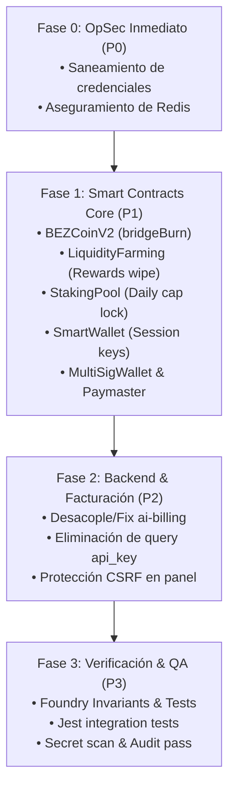

# Plan de Desarrollo y Remediación de Seguridad — BeZhas Blockchain

**Fecha de Creación:** 12 de noviembre de 2026  
**Documento Base:** Auditoría Estática de Seguridad BeZhas (`docs/audit/`)  
**Estado:** Pendiente de Ejecución  
**Responsable Técnico:** Equipo de Desarrollo Core & Smart Contracts  

---

## 1. Resumen y Objetivos

Este plan establece la hoja de ruta técnica, priorizada y ejecutable para mitigar las 11 vulnerabilidades detectadas en la auditoría de seguridad del ecosistema BeZhas.

El objetivo principal es eliminar los vectores de pérdida o bloqueo de fondos, prevenir denegaciones de servicio (DoS) en infraestructura crítica de la red L2, remediar fugas de credenciales en repositorios locales y corregir inconsistencias en la facturación y ejecución de contratos inteligentes.



---

## 1.1 Alcance acordado (2026-11-13)

Por ahora BeZhas se queda sólo con **BEZ-Coin en Polygon** (ver `docs/reference/ESTADO_REDES_Y_TOKEN.md`). Contrastado con `smart-contracts/deployments/137.json`, que sólo tiene desplegados `BEZCoin`, `BezhasToken`, `QualityEscrow`, `RWAFactory`, `GovernanceSystem`, `LiquidityFarming`, `NFTOffers`, `Marketplace` y `AdminRegistry`:

| Tarea | Estado |
| :--- | :--- |
| 1.1 `BEZCoinV2.bridgeBurn` (SEC-02) | **Fuera de alcance.** `BEZCoinV2` es el token de la L2 propia, que no está en uso. Retomar sólo si se activa la L2 |
| 1.2 `LiquidityFarming` (SEC-03) | **En alcance:** está desplegado en Polygon. Verificar el hallazgo contra el contrato y su dirección antes de habilitar liquidez |
| 1.2 `LiquidityFarming` (SEC-03) | **Corregido en el código** (`93b19c7e`); el desplegado en Polygon es una versión anterior sin pools |
| 1.3 `StakingPool` (SEC-04) | **Corregido en el código** (`9579ca14`). Sin desplegar |
| 1.4 `SmartWallet` (SEC-05) | **Corregido en el código** (`55d792ef`). Sin desplegar |
| 1.6 `MultiSigWallet` (SEC-07) | **Corregido en el código** (`c74ed6e6`). Sin desplegar |
| 1.7 `Paymaster` (SEC-08) | **Corregido en el código** (`03734ace`). Sin desplegar |
| 1.5 `BeZhasDEX` (SEC-06) | **Corregido en el código** (acumuladores TWAP + oráculo del Hub). Sin desplegar. Falta un keeper que llame a `updateObservation` cada 30 min |
| Fase 0 y Fase 2 (backend) | En alcance. La Fase 2 se corrigió el 2026-11-12 (commit `71aef29c`) |
| 0.2 Redis (SEC-11) | **Corregido (2026-11-15):** `requirepass` obligatorio en `docker-compose.yml` (sin `REDIS_PASSWORD` no arranca), puerto sólo en 127.0.0.1, `REDIS_URL` con clave en los compose y en `.env.example`. Probado en un contenedor desechable: sin clave `NOAUTH`, con clave `PONG`. El contenedor `bezhas-redis` en marcha sigue sin clave hasta recrearlo con `docker compose up -d` |
| 0.1 Secretos (SEC-01) | **Parcial.** Los ficheros de claves salieron del repositorio (`~/secretos-bezhas`). `scan-secrets` ya no cuenta los `.env` ignorados por git como fallo del repositorio (los avisa aparte) y `audit:production` da `READY`. **Siguen 15 credenciales reales en `.env` locales** (OpenAI, JWT, una clave de Amoy): rotarlas es acción del propietario |

**Dependencias (2026-11-15).** `pnpm audit --prod` en todos los módulos con lockfile: sin avisos altos ni críticos salvo uno (`zod` 3 vía `viem` en `Bezhas-Hub/frontend-next`, parche sólo en zod 4). Críticos resueltos: `proxy-addr` y `shell-quote` (raíz). Quedan avisos moderados o bajos que no se pueden cerrar sin cambiar de major o de librería: `stream-json` 1 en `business-ops` (la 3 rompe `minio`), `request` y `uuid` 3/8 de `node-telegram-bot-api` en `agent-lib` y `scripts` (`request` está abandonado), `react-router` 6 en las SubApps. Los `overrides` están acotados por major en cada `pnpm-workspace.yaml`.

---

## 2. Fase 0: Saneamiento Inmediato y OpSec (Prioridad Crítica / P0)

**Objetivo:** Detener la exposición de claves privadas y credenciales en texto plano en el entorno de desarrollo y restringir el acceso a la infraestructura base.

### Tarea 0.1: Retiro y Rotación de Secretos Expuestos (SEC-01)
* **Archivos afectados:**
  * [Billetera Yoroi frases de recuperación.txt](file:///home/amaliacr/Documentos/BeZhas-Blockchain/Billetera%20Yoroi%20frases%20de%20recuperaci%C3%B3n.txt)
  * [bezhas_subapp_credentials.txt](file:///home/amaliacr/Documentos/BeZhas-Blockchain/bezhas_subapp_credentials.txt)
  * [.env](file:///home/amaliacr/Documentos/BeZhas-Blockchain/.env) y backups asociados (`.env.bak-*`)
  * [smart-contracts/.env.amoy](file:///home/amaliacr/Documentos/BeZhas-Blockchain/smart-contracts/.env.amoy)
* **Acciones:**
  1. Transferir los activos remanentes de cualquier dirección cuya clave privada o semilla mnemónica haya estado en texto plano a una nueva billetera fría / multisig segura.
  2. Rotar todas las claves API comprometidas (OpenAI, Anthropic, Stripe, JWT secrets).
  3. Mover estos archivos fuera del repositorio o asegurar que estén en un almacén cifrado local o gestor de secretos (GCP Secret Manager o HashiCorp Vault).
  4. Ejecutar `pnpm run security:scan-secrets` para confirmar que el reporte finalice en 0 hallazgos de alto riesgo.

### Tarea 0.2: Aseguramiento de Redis en Docker Compose (SEC-11)
* **Archivo afectado:** [docker-compose.yml](file:///home/amaliacr/Documentos/BeZhas-Blockchain/docker-compose.yml#L26-L32)
* **Acciones:**
  1. Configurar contraseña obligatoria en la directiva de arranque de Redis:
     ```yaml
     command: redis-server --requirepass "${REDIS_PASSWORD:?define REDIS_PASSWORD}" --maxmemory 2gb --maxmemory-policy allkeys-lru --appendonly yes
     ```
  2. Restringir la exposición del puerto únicamente a la interfaz local (`127.0.0.1`):
     ```yaml
     ports:
       - "127.0.0.1:${REDIS_HOST_PORT:-6380}:6379"
     ```
  3. Actualizar la cadena de conexión en los clientes [api/cache/redis.js](file:///home/amaliacr/Documentos/BeZhas-Blockchain/api/cache/redis.js).

---

## 3. Fase 1: Remediación de Contratos Inteligentes (Prioridad Crítica & Alta / P1)

**Objetivo:** Corregir vulnerabilidades lógicas en contratos desplegados o pendientes de despliegue antes de habilitar liquidez o transferencias masivas.

### Tarea 1.1: Quema Real de Tokens en el Puente L2 (SEC-02)
* **Archivo:** [smart-contracts/src/tokens/BEZCoinV2.sol](file:///home/amaliacr/Documentos/BeZhas-Blockchain/smart-contracts/src/tokens/BEZCoinV2.sol#L54)
* **Problema:** `bridgeBurn` realiza una transferencia hacia la tesorería en lugar de destruir tokens, provocando una inflación artificial del suministro y un eventual DoS irreversible del puente cuando `totalSupply == MAX_SUPPLY`.
* **Solución Técnica:**
  ```solidity
  function bridgeBurn(address from, uint256 amount) public onlyRole(BRIDGE_ROLE) {
      _burn(from, amount);
  }
  ```
* **Prueba Requerida:** Invariant test en Foundry simulando 10.000 depósitos y retiros sucesivos verificando que `totalSupply()` no crezca artificialmente y que `MAX_SUPPLY` solo compute tokens activos reales.

---

### Tarea 1.2: Preservación de Recompensas en `LiquidityFarming` (SEC-03)
* **Archivo:** [smart-contracts/src/core/LiquidityFarming.sol](file:///home/amaliacr/Documentos/BeZhas-Blockchain/smart-contracts/src/core/LiquidityFarming.sol#L165-L182) y [Línea 222-234](file:///home/amaliacr/Documentos/BeZhas-Blockchain/smart-contracts/src/core/LiquidityFarming.sol#L222-L234)
* **Problema:** En `deposit()` y `withdraw()`, el recálculo directo de `user.rewardDebt` borra cualquier recompensa no reclamada.
* **Solución Técnica:**
  Opción A: Ejecutar una liquidación automática (`claim`) de las recompensas pendientes antes de actualizar el saldo del usuario.
  Opción B: Acumular la recompensa pendiente en un balance interno:
  ```solidity
  uint256 pending = ((user.amount * pool.accBezPerShare) / 1e12) - user.rewardDebt;
  if (pending > 0) {
      user.pendingRewards += pending;
  }
  ```
* **Prueba Requerida:** Test unitario verificando que tras un depósito inicial, acumulación de bloques y un segundo depósito o retiro, las recompensas devengadas previas sigan siendo cobrables al 100%.

---

### Tarea 1.3: Retiro Flexible y Reclamo Parcial en `StakingPool` (SEC-04)
* **Archivo:** [smart-contracts/src/core/StakingPool.sol](file:///home/amaliacr/Documentos/BeZhas-Blockchain/smart-contracts/src/core/StakingPool.sol#L128-L152)
* **Problema:** El límite diario `DAILY_EMISSION_CAP` bloquea de forma permanente a usuarios con recompensas acumuladas superiores a 50.000 BEZ, impidiendo además la ejecución de `exit()`.
* **Solución Técnica:**
  1. Permitir que `getReward()` pague únicamente hasta el remanente disponible del día en lugar de revertir:
     ```solidity
     uint256 availableToday = DAILY_EMISSION_CAP > epochDailyEmitted ? DAILY_EMISSION_CAP - epochDailyEmitted : 0;
     uint256 payout = boostedReward > availableToday ? availableToday : boostedReward;
     
     // Descontar base equivalente y conservar el resto en rewards[msg.sender]
     ```
  2. Modificar `exit()` para que el retiro del capital principal (`withdraw`) no dependa del éxito de `getReward()` (si el límite diario está agotado, permitir retirar el stake principal sin fallar).

---

### Tarea 1.4: Delimitación de Alcance en Session Keys de `SmartWallet` (SEC-05)
* **Archivo:** [smart-contracts/src/wallet/SmartWallet.sol](file:///home/amaliacr/Documentos/BeZhas-Blockchain/smart-contracts/src/wallet/SmartWallet.sol#L207-L222)
* **Problema:** `executeBySession` solo comprueba `session.spent + value <= session.spendLimit` (moneda nativa). Un atacante con session key puede llamar a `IERC20.transfer` con `value = 0` y vaciar los tokens de la wallet.
* **Solución Técnica:**
  1. Agregar a la estructura `Session` un mapeo o hash de permisos:
     ```solidity
     struct Session {
         address sessionKey;
         uint256 validUntil;
         uint256 spendLimit;
         uint256 spent;
         address targetContract;      // Contrato único permitido (o address(0) para nativo)
         bytes4 allowedSelector;       // Selector permitido (ej. 0x0 para transfer simple)
     }
     ```
  2. Validar `target` y `bytes4(data)` en `executeBySession`.

---

### Tarea 1.5: Oráculo TWAP o Descentralizado para `BeZhasDEX` (SEC-06)
* **Archivos:**
  * [smart-contracts/src/core/BeZhasDEX.sol](file:///home/amaliacr/Documentos/BeZhas-Blockchain/smart-contracts/src/core/BeZhasDEX.sol#L196-L206)
  * [App-nativas/Bezhas-Hub/backend/services/price-oracle.service.js](file:///home/amaliacr/Documentos/BeZhas-Blockchain/App-nativas/Bezhas-Hub/backend/services/price-oracle.service.js#L57)
* **Problema:** Lectura del precio spot directo de reservas sin ventana de tiempo, vulnerable a Flash Loan y manipulación de reservas.
* **Solución Técnica:**
  1. Añadir acumuladores `price0CumulativeLast` y `price1CumulativeLast` en `BeZhasDEX` según el estándar Uniswap v2 para permitir consultas TWAP ponderadas por tiempo.
  2. En el backend `price-oracle.service.js`, exigir un mínimo de confirmaciones o integrar el oráculo de Chainlink Polygon (`POL/USD` y `USDC/USD`) como ancla primaria de precios.

---

### Tarea 1.6: Corrección de Gobernanza y Despausa en `MultiSigWallet` (SEC-07)
* **Archivo:** [smart-contracts/src/wallet/MultiSigWallet.sol](file:///home/amaliacr/Documentos/BeZhas-Blockchain/smart-contracts/src/wallet/MultiSigWallet.sol#L222-L225)
* **Acciones:**
  1. Modificar `unpause()` para que sea invocable mediante el quórum normal de la multisig (`onlyWallet`) o mediante confirmación de múltiples firmantes en lugar de depender exclusivamente de `signers[0]`.
  2. En `removeSigner`, recorrer las transacciones pendientes (`!transactions[i].executed`) y decrementar `confirmations` si el firmante revocado había votado a favor.

---

### Tarea 1.7: Desbloqueo de Fondos por Desactivación en `Paymaster` (SEC-08)
* **Archivo:** [smart-contracts/src/wallet/Paymaster.sol](file:///home/amaliacr/Documentos/BeZhas-Blockchain/smart-contracts/src/wallet/Paymaster.sol#L115-L121)
* **Acciones:**
  1. Permitir que una empresa desactivada pueda retirar su saldo remanente (`balance > 0`) o habilitar una función de rescate/reembolso administrativo hacia la dirección registrada de la empresa.

---

## 4. Fase 2: Backend, Facturación y Control de Acceso (Prioridad Media & Alta / P2)

**Objetivo:** Cerrar vías de elusión de facturación en la API y reforzar la autenticación.

### Tarea 2.1: Saneamiento del Flujo Heredado `ai-billing` (SEC-09)
* **Archivos:**
  * [api/routes/ai-billing.js](file:///home/amaliacr/Documentos/BeZhas-Blockchain/api/routes/ai-billing.js#L145)
  * [api/services/aiBillingService.js](file:///home/amaliacr/Documentos/BeZhas-Blockchain/api/services/aiBillingService.js#L83) y [Línea 125](file:///home/amaliacr/Documentos/BeZhas-Blockchain/api/services/aiBillingService.js#L125)
* **Acciones:**
  1. Eliminar o deshabilitar `POST /api/ai-billing/subscribe` si el sistema de facturación oficial migró a Stripe Checkout / OPERANT.
  2. En `payInvoice`, verificar la transacción on-chain real (`txHash`) donde se demuestre la transferencia de fondos al Paymaster antes de marcar `status = 'paid'`.

### Tarea 2.2: Eliminación de `api_key` en URLs (SEC-10)
* **Archivo:** [enterprise-node/server.js](file:///home/amaliacr/Documentos/BeZhas-Blockchain/enterprise-node/server.js#L27)
* **Acciones:**
  1. Eliminar `req.query.api_key` del middleware `requireAuth`.
  2. Rechazar peticiones que envíen credenciales por URL y exigir el uso exclusivo de `Authorization: Bearer <key>` o `X-API-Key`.
  3. Utilizar `crypto.timingSafeEqual` para comparar la clave API.

### Tarea 2.3: Protección CSRF en Panel de Administración
* **Archivo:** [api/routes/admin-auth.js](file:///home/amaliacr/Documentos/BeZhas-Blockchain/api/routes/admin-auth.js#L117)
* **Acciones:**
  1. Implementar validación de cabecera personalizada (ej. `X-Requested-With` o `X-CSRF-Token`) en todas las peticiones `POST`, `PUT`, `DELETE` protegidas por cookie de administración.
  2. Cambiar `sameSite: 'lax'` por `sameSite: 'strict'` en las cookies de sesión del panel administrativo.

---

## 5. Fase 3: Pruebas, Validación y Criterios de Aceptación (P3)

### Criterios de Aceptación (Definition of Done)

- [x] **OpSec Clean (repositorio):** `pnpm run security:scan-secrets` da 0 hallazgos versionables; 15 avisos de `.env` locales pendientes de rotar.
- [ ] **Tests de Smart Contracts:** Todas las suites de pruebas de Foundry (`forge test`) pasan al 100%, incluyendo tests de invariantes para `BEZCoinV2` y `LiquidityFarming`.
- [x] **Auditoría de Listo para Producción:** `pnpm run audit:production` finaliza con estado `READY` (2026-11-15).
- [ ] **Facturación Verificada:** Ninguna suscripción ni factura en base de datos se marca como activa/pagada sin un identificador de pago externo comprobable (Stripe event ID o `tx_hash` on-chain).
- [x] **Docker Hardened:** Redis requiere contraseña en el compose y su puerto sólo escucha en `127.0.0.1` (producción usa Memorystore, no este compose).

---

## 6. Cronograma Estimado de Ejecución

| Hito | Alcance | Duración Estimada |
| :--- | :--- | :--- |
| **Hito 1** | Fase 0 (OpSec, rotación de claves, limpieza de archivos `.txt`, Redis) | 1 día |
| **Hito 2** | Fase 1 (Smart Contracts: BEZCoinV2, LiquidityFarming, StakingPool) | 2 - 3 días |
| **Hito 3** | Fase 1 (Smart Contracts: SmartWallet, MultiSigWallet, Paymaster, DEX TWAP) | 2 días |
| **Hito 4** | Fase 2 (Backend: ai-billing, enterprise-node, CSRF) | 1 - 2 días |
| **Hito 5** | Fase 3 (Foundry tests, integración Jest, preflight final) | 1 día |
| **Total** | Despliegue completo y validado | **7 - 9 días hábiles** |
