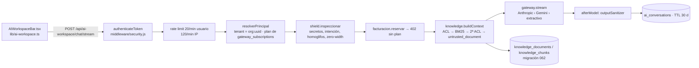

# BeZhas AI / RAG — Estado real y plan de desarrollo

**Fecha:** 2026-10-15 · **Rama:** `feat/seguridad-transaccional-mcp` · **Origen:** `BEZHAS-RAG-AUDIT-IMPLEMENTATION-ONLINE-MASTER-PROMPT.md` (v1.0.0)

El documento maestro pide auditar antes de construir. Esta es esa auditoría, hecha contra el código, y el plan que sale de ella. Conclusión principal: **el RAG y el chat no hay que construirlos, ya existen y están en producción**. El trabajo consiste en endurecerlos, medirlos y unificar canales. Un rediseño no tiene sentido.

---

## 1. Qué hay hoy (con evidencia)

### Flujo real de un mensaje

Sin sesión: `/api/ai-workspace/public` (una pregunta gratis, 10/min por IP) y `/api/public-chat`.

### Clasificación por capacidad

| Capacidad | Estado | Evidencia |
|---|---|---|
| Almacén documental persistente (Postgres) | IMPLEMENTADO Y VERIFICADO | `api/services/knowledge/store.js` (`PgStore`), `db/migrations/062_ai_workspace.sql` |
| Tenant derivado de la sesión, nunca del body | IMPLEMENTADO Y VERIFICADO | `ai-workspace/principal.js`; test «el tenantId del body se ignora» (`routes/ai-workspace.test.js:86`) |
| ACL antes de rankear + 2ª ACL contra versión vigente | IMPLEMENTADO Y VERIFICADO | `knowledge.service.js` `search()` pasos 1 y 3; `acl.js` `canAccess` |
| Clasificaciones PUBLIC…SECRET; SECRET nunca indexable | IMPLEMENTADO Y VERIFICADO | `acl.js`, `ingest()` → 422 |
| Aislamiento entre tenants | IMPLEMENTADO Y VERIFICADO (unitario) | canarios en `ai-security-hardening.test.js:49`; sin prueba e2e contra Postgres |
| Retrieval BM25 propio con raíz española y umbral de cobertura | IMPLEMENTADO Y VERIFICADO | `knowledge/bm25.js`, `knowledge-bm25.test.js` |
| Híbrido BM25 + vector (RRF) | PARCIAL | el código RRF existe en `search()`, pero **no hay embedder conectado** (`index.js` crea `KnowledgeService` sin él) ni columna de embedding en la 062 |
| Citas `[n]` con documento/versión/sección | IMPLEMENTADO, EVIDENCIA INSUFICIENTE | `buildContext()` devuelve `sources`; nadie comprueba que la cita del modelo apunte al fragmento correcto |
| Abstención sin evidencia | PARCIAL | `minCoverage` y modo extractivo lo hacen; con LLM depende sólo del prompt |
| Cuarentena por prompt injection en documentos | IMPLEMENTADO Y VERIFICADO | `injectionGuard.js` (regex acotadas anti-ReDoS) |
| Escudo de entrada (secretos, BIP-39, homoglifos, zero-width) | IMPLEMENTADO Y VERIFICADO | `ai-workspace/shield.js`, `ai-shield.test.js` — la brecha «sólo NFD» del documento **ya no es cierta** en el chat; sigue siéndolo en `bm25.tokenize` y en `injectionGuard.scan` |
| Saneado de salida | IMPLEMENTADO Y VERIFICADO | `outputSanitizer.js` vía hook `afterModel` |
| Streaming SSE con cancelación | IMPLEMENTADO Y VERIFICADO | `responderEnStream`, `gateway.stream` |
| Degradación sin proveedor (modo extractivo) | IMPLEMENTADO Y VERIFICADO | `gateway.js` `extractiveText`, techo diario `AI_GLOBAL_DAILY_CALLS` |
| Facturación por plan / 402 | IMPLEMENTADO Y VERIFICADO | `ai-workspace/billing.js`, `ai-billing.test.js` |
| Validación JWT `iss`/`aud` | PARCIAL | existe en `middleware/security.js:46`, pero **sólo si el token trae el campo**; `JWT_STRICT_CLAIMS` no aparece en `deploy/` |
| Ingestión de PDF/DOCX/HTML | AUSENTE | `POST /knowledge` sólo acepta texto en JSON (≤256 KB) |
| Corpus de evaluación / recall@k / benchmark | AUSENTE | sólo tests unitarios de ranking |
| Métricas de RAG (latencia retrieval, abstenciones, citas) | AUSENTE | — |
| MCP y API/SDK usando el mismo Knowledge Plane | AUSENTE | `routes/mcp-public.js` y `mcp-gateway.js` no llaman a `knowledge` |
| Ollama / modelo local | AUSENTE en el chat | `gateway.js` sólo tiene Anthropic, Gemini y extractivo |

**Tests ejecutados hoy:** 8 suites, 140 tests, todos en verde (`pnpm exec jest` sobre knowledge-bm25, knowledge-seed, ai-gateway, ai-shield, ai-security-hardening, ai-guide, ai-workspace, public-chat; exit 0, 5,3 s).
**Producción:** `https://api.bezhas.com/api/ai-workspace/actions` → 401 sin token (la ruta está desplegada y exige sesión). No he hecho ninguna llamada autenticada.

**Madurez:** RAG de producción temprana, con la parte de seguridad por encima de la media. Las carencias que quedan están en la medición (no hay benchmark), en la escala (ver H2) y en que los tres canales no usan el mismo motor.

---

## 2. Hallazgos que el documento no recoge

| # | Severidad | Hallazgo | Dónde |
|---|---|---|---|
| H1 | **Alta** | Tokens sin `iss`/`aud` se aceptan mientras `JWT_STRICT_CLAIMS` no esté a `true`. El token de servicio de `hitlMirror` (`role: 'service'`, sin iss/aud) firmado con el mismo `JWT_SECRET` es hoy un token válido para `authenticateToken`, y por tanto para el chat. El refresh de SSO lleva `type: 'refresh'` y nadie lo rechaza explícitamente; ahora lo frena sólo el `iss: 'bezhas-core'` distinto. | `middleware/security.js:46`, `services/hitlMirror.js:55`, `services/ssoService.js:52` |
| H2 | **Alta (escala/corrección)** | `chunksVisibles` trae hasta 5000 chunks **sin ORDER BY** y el BM25 se calcula en Node en cada mensaje. Cuando un tenant pase de ~5000 chunks, Postgres recortará filas arbitrarias: puede caer el conocimiento global o documentos propios sin que nadie lo vea. También es coste de CPU/latencia por mensaje. | `knowledge/store.js` `chunksVisibles` |
| H3 | Media (verificar) | Modelo por defecto `claude-sonnet-5`. Si ese id no es válido, cada llamada falla y el chat se degrada **en silencio** a extractivo. Hay que confirmar `AI_MODEL_ANTHROPIC` en Cloud Run o fijar un id vigente. | `ai-workspace/gateway.js:14` |
| H4 | Media | El techo diario de IA y los rate limits viven en memoria de cada instancia: con N instancias de Cloud Run, el techo real es N × `AI_GLOBAL_DAILY_CALLS`. | `gateway.js` `presupuesto`, `express-rate-limit` sin store compartido |
| H5 | Baja | El principal se cachea 60 s: si se revoca un plan o un rol, el cambio tarda hasta un minuto en aplicarse. | `principal.js` `CACHE_MS` |
| H6 | Baja | `bm25.tokenize` e `injectionGuard.scan` normalizan sólo NFD: un documento con zero-width o homoglifos esquiva la cuarentena (el escudo del chat sí los trata). | `bm25.js`, `injectionGuard.js` |

---

## 3. Qué partes del documento aplicar y cuáles no

| Propuesta del documento | Decisión | Motivo |
|---|---|---|
| Fase 0 de auditoría | **Hecha** (este archivo) | — |
| Mantener stack (Express + Postgres + BM25) | **Sí** | funciona, tiene tests y está desplegado |
| pgvector / híbrido | **Sólo tras benchmark** | el hueco para el RRF ya existe; la primera mejora barata es Postgres FTS (H2) |
| Vector DB separado | **No** | el volumen actual (≈33 docs globales + docs de tenants) no lo justifica |
| Ollama `qwen3.5:2b` en host de 8 GB | **No en producción ahora** | producción es Cloud Run sin GPU, y la máquina de desarrollo no tiene driver NVIDIA (CLAUDE.md). Se añade como proveedor opcional detrás de flag, con su benchmark, para clasificación/extracción en un host privado. |
| AI Gateway / Agent Core únicos para Web, MCP y API | **Sí, de forma incremental** | hoy sólo el chat web usa el Knowledge Plane |
| Onboarding dinámico y API Profile (Fases 5–6 del doc) | **Plan aparte** | ya hay `onboardingSession.js` y `mcp-onboarding-tools.js`; necesita una auditoría propia antes de tocarlo |
| Acciones con efectos (pagos, tokenización) desde el chat | **No** | el chat sólo abre pantallas registradas (`actions.js`); se mantiene así |

---

## 4. Plan de desarrollo

Cada fase va en commits pequeños, con tests y con feature flag cuando cambie el comportamiento del chat en producción.

### Fase 1 — Seguridad bloqueante (1–2 días)
1. **JWT estricto (H1).** Que `hitlMirror`, `admin-console` y `ssoService` firmen con `iss`/`aud` propios (o con un secreto propio para servicio). Rechazar `type: 'refresh'` y `role: 'service'` en `authenticateToken`. Añadir tests de aceptación por cada emisor. Después, `JWT_STRICT_CLAIMS=true` en `deploy/gcp`. Cuidado: los tokens viejos sin iss/aud dejan de valer, y los usuarios tendrán que volver a iniciar sesión.
2. **Modelo vigente (H3).** Leer `AI_MODEL_ANTHROPIC` en Cloud Run y fijar un id válido. Registrar un `warn` con contador cuando el proveedor degrade a extractivo, para que la degradación deje de ser silenciosa.
3. **Unicode en ingestión (H6).** Reutilizar la normalización de `shield.js` (zero-width, homoglifos, NFKC) en `injectionGuard.scan` y `bm25.tokenize`. Tests con documentos envenenados camuflados.

**Hecho cuando:** test negativo por cada tipo de token ajeno, flag activo en staging y suites verdes.

### Fase 2 — RAG medible (2–3 días)
1. `api/__tests__/fixtures/rag-eval/`: corpus versionado de 60–100 preguntas (con respuesta, sin respuesta, ES/EN, identificadores exactos, adversariales, cruce de tenants), etiquetado con el `document_id` esperado.
2. Script `api/scripts/rag-eval.js` que mide recall@4, precision@4, abstención correcta y latencia p50/p95 del retrieval. Se guarda un baseline del BM25 actual.
3. Comprobación de citas: después del modelo, validar que cada `[n]` existe en `sources`; las inexistentes se quitan o se marcan.
4. Test de aislamiento e2e contra Postgres real (CI con servicio postgres): documento del tenant A nunca aparece para B, ni en búsqueda ni en listado ni en historial.

**Hecho cuando:** existe el baseline publicado en `docs/audit/RAG-TEST-BASELINE.md` y el test e2e está en CI.

### Fase 3 — Escala del retrieval (2 días)
1. Migración nueva (063): columna `tsv tsvector` generada con `to_tsvector('spanish', …)` e índice GIN en `knowledge_chunks`.
2. `PgStore.candidatos(tenantId, query, n=200)` hace el prefiltro FTS en SQL (tenant + status + vigencia), y el BM25 actual reordena sólo esos candidatos. Se elimina el `LIMIT 5000` ciego (H2).
3. Detrás de `KNOWLEDGE_RETRIEVAL=fts` y comparado contra el baseline de la Fase 2. Sólo se activa si no empeora recall@4.
4. Embeddings con pgvector **sólo si** la Fase 2 muestra fallos semánticos claros. El RRF ya está escrito; faltan el embedder y la columna.

### Fase 4 — Ingestión de documentos reales (2–3 días)
1. Subida de PDF/DOCX/MD/TXT con límites de tipo y tamaño. Comprobar primero si `services/documentService.js` y `routes/documents.js` ya tienen parsers reutilizables antes de añadir dependencias.
2. Deduplicación por checksum, versionado (ya existe) y borrado efectivo (ya existe; añadir test de que lo borrado no vuelve a salir).
3. Referencias de página/sección en el chunk.

### Fase 5 — Un solo Knowledge Plane para Web, MCP y API (2 días)
1. Herramienta MCP de solo lectura `bezhas_knowledge_search` en `mcp-gateway.js`. Usa `knowledge.search` con el principal derivado del token OAuth/api-key, nunca de los argumentos.
2. Endpoint equivalente en el Gateway (`x-api-key`) con el mismo principal y la misma facturación.
3. Test que compruebe que los tres canales devuelven lo mismo para el mismo principal y nada de otro tenant.

### Fase 6 — Operación (1–2 días)
1. Métricas por mensaje en log JSON: `request_id`, latencia del retrieval, nº de fuentes, cobertura máxima, proveedor, abstención y degradación (sin el texto del prompt).
2. Techo diario y rate limits con store compartido (Memorystore ya existe en la topología GCP) (H4).
3. Kill switches por variable de entorno: `AI_PROVIDER=extractive` (ya existe), más `KNOWLEDGE_TENANT_DOCS=off` y `AI_WORKSPACE_ENABLED=false`.
4. `docs/runbooks/BEZHAS-AI-DEPLOYMENT.md` y `BEZHAS-AI-ROLLBACK.md`: despliegue con `scripts/gcp-deploy.sh`, migración 063 vía `bezhas-db-migrate`, rollback de revisión de Cloud Run.

### Fase 7 — Proveedor local opcional (cuando haya hardware)
1. Proveedor `ollama` en `gateway.js` (misma interfaz, `OLLAMA_URL` privada) detrás de `AI_PROVIDER`. Nunca fallback silencioso a cloud con datos de tenant.
2. Benchmark del documento (30–100 rondas, TTFT/p95, VRAM, JSON válido) en el host real. Antes hacen falta modelo de GPU, VRAM, SO y si es el mismo servidor de producción.
3. Uso inicial sólo en clasificación de intención y extracción de campos, no en las respuestas RAG a clientes.

### Gates de salida a producción (de cada fase)
Suites verdes → tests negativos de tenant → staging en Cloud Run con flag → eval sin regresión frente al baseline → despliegue → smoke contra `api.bezhas.com` (401 sin token, 200 con token de prueba, cita presente).

---

## 5. Bloqueos que sólo puede resolver el propietario
1. Confirmar el valor actual de `AI_MODEL_ANTHROPIC` y si hay `ANTHROPIC_API_KEY` válida en Secret Manager. Gemini y OpenAI no sirven ahora mismo: la clave de Gemini es inválida y OpenAI no tiene créditos.
2. Aprobar que `JWT_STRICT_CLAIMS=true` cierre las sesiones con tokens antiguos.
3. Aprobar la migración 063 en el Cloud SQL de producción. Recordatorio: 049–051 siguen sin aplicar.
4. Para la Fase 7: el hardware real del host de inferencia (GPU, VRAM, RAM, SO, ubicación).
