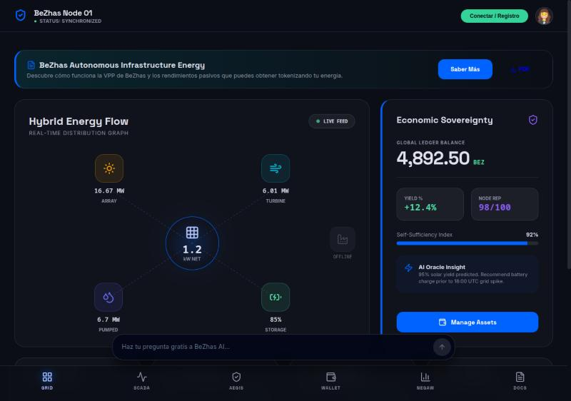
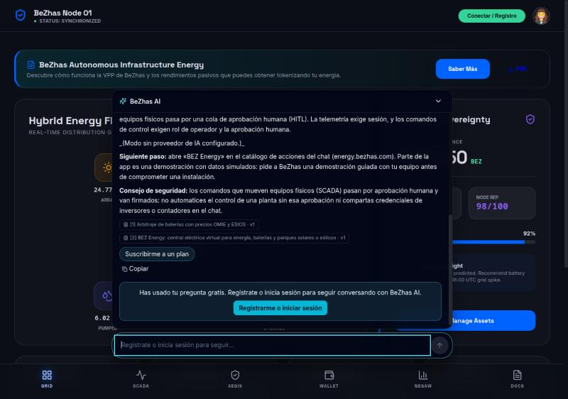
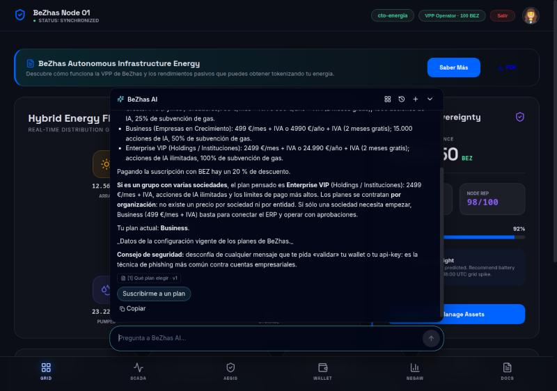
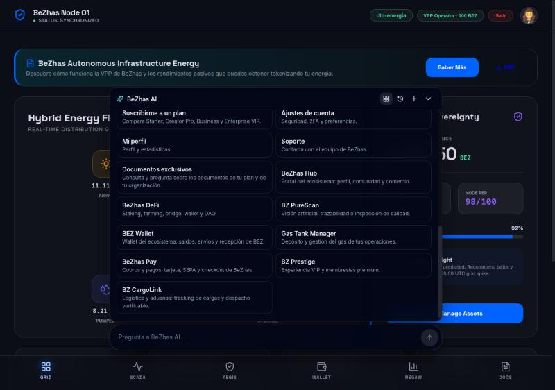
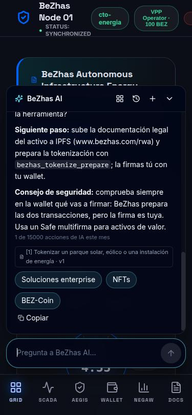
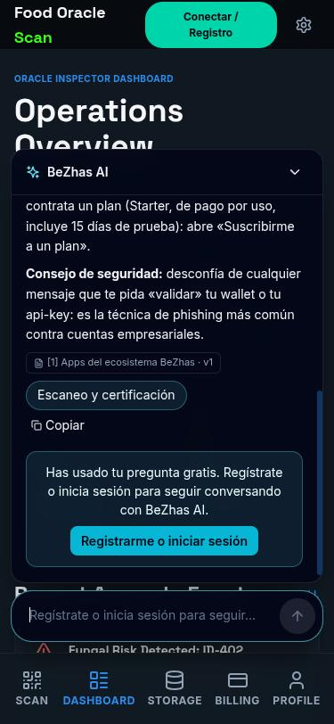
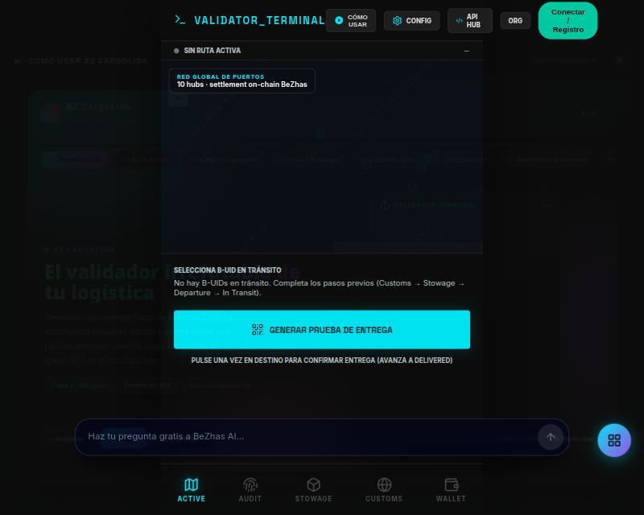
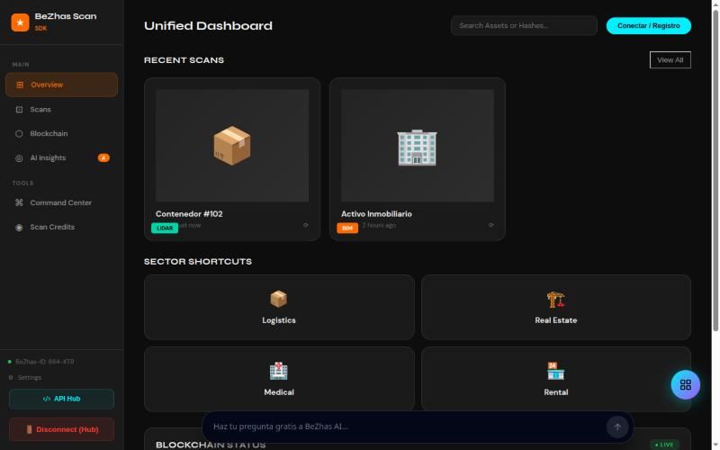

# BEZ Energy: el chat de la plataforma sustituye al widget antiguo

**Fecha:** 2026-10-15 · **Cambio:** `App-nativas/bez-energy` usa ahora el mismo chat que www.bezhas.com (barra inferior «BeZhas AI») en lugar del widget `bz-chat.js` (burbuja verde 💬). Componente compartido en `App-nativas/_shared/ai-chat/` (ver su README).

## Antes y después

| Antes | Después |
|---|---|
|  Burbuja verde abajo a la derecha: chat público distinto del de la web (palabras clave, sin sesión, sin planes, sin streaming). |  La barra «BeZhas AI» de la web, encima de la navegación de Energy. |

## Comprobado en el navegador (Energy en local, API de la rama, modelo local `qwen3.5:4b`)

1. **Visitante sin sesión** — una pregunta gratis con fuentes citadas y, después, la tarjeta «Registrarme o iniciar sesión» (abre el inicio de sesión de Energy). 
2. **Con sesión de Energy** — el chat usa la **misma sesión** que la cabecera de la app (no pide otro login), responde con el plan del usuario y muestra «Tu plan actual». 
3. **Catálogo de acciones** — el mismo de la web; la tarjeta *BEZ Energy* no aparece porque ya estás en esa app (así no hay un enlace que te lleva al mismo sitio). 
4. **Móvil (375×812)** — la barra queda sobre la navegación inferior y el panel cabe sin desbordar. 

## Qué se ha cambiado
- `App-nativas/_shared/ai-chat/{AIWorkspaceBar.jsx, ai-workspace.js, ai-chat.css, README.md}`: el chat, portado desde `control-center` (sin Tailwind, estilos acotados a `.bzai`).
- `bez-energy/src/App.jsx`: monta `<AIWorkspaceBar hideAppId="app_energy" bottomOffset={92} suggestions={…}/>` con tres sugerencias de energía.
- `bez-energy/index.html`: quita `bz-chat.js`. `bez-energy/vite.config.js`: `lucide-react` en `resolve.dedupe`.
- Tests: `_shared/__tests__/ai-chat.test.mjs` (18 pruebas de `_shared`, 9 nuevas) y `control-center/frontend/__tests__/lib/ai-workspace-parity.test.ts` (el Markdown seguro da la misma salida en las dos copias).

## Límites y pendiente
- **No desplegado.** Hay que reconstruir y desplegar Energy (`deploy/gcp/deploy-subapps.sh energy`). El build de producción de Vite sale bien en local; el build con el Dockerfile de las SubApps **no se ha ejecutado**.
- **Estado por SubApp** (el chat compartido sustituye a `bz-chat.js`):

  | SubApp | Estado | Notas |
  |---|---|---|
  | BEZ Energy | ✅ migrada y probada | — |
  | BZ PureScan | ✅ migrada y probada (móvil) |  |
  | BZ CargoLink | ✅ migrada, compilada y vista en el navegador | la barra queda sobre su navegación inferior  |
  | BEZ Vision Scan | ✅ migrada, compilada y vista en escritorio | la barra se desplaza a la derecha de su barra lateral (`leftOffset`) . En móvil la propia app se desborda (ya lo hacía) |
  | BZ Prestige, BEZ Wallet, Gas Tank, Edge Node Manager, BZ Genesis | ✅ migradas y compiladas; sin revisión visual | Mismo montaje (dentro de su `AuthProvider`, que ya era una fachada de `BezhasAuthProvider`) |
  | BeZhas Pay Manager | ⛔ se deja con el widget antiguo | Es una pasarela de pago: la barra fija tapa parte del selector de métodos de pago; hace falta decidir dónde va (p. ej. sólo en el panel de comercio, no en el checkout) |
  | BZ Sphere | ⛔ se deja con el widget antiguo | Es una app de mensajería con su propia caja de texto fija abajo: dos cajas de chat apiladas confundirían más |
  | Hub (Next.js) y BZ Capital | — | No usaban `bz-chat.js`; fuera de este cambio |

  Edge y Genesis no figuran en `deploy-subapps.sh`, así que no se despliegan desde ahí.
- El texto del «siguiente paso» de energía lo escribe el servidor y dice «abre BEZ Energy en el catálogo de acciones» incluso estando ya en Energy. Corregirlo exige que la SubApp diga al servidor en qué app está (cabecera nueva → hay que añadirla al CORS de la API). No se ha hecho.
- La prueba usó una API local con base de datos simulada y las rutas `/api/energy/*` sin montar (404 esperados); no se probó el inicio de sesión real por email o wallet de Energy contra la API de producción.
- No hay prueba automática del componente React (Energy no tiene entorno de test de componentes); la cobertura es la lógica compartida y la prueba en el navegador.
