# BeZhas para el sector energía: prueba de uso como CTO de un grupo energético

**Fecha:** 15-oct-2026 · **Rama probada:** `feat/rag-endurecimiento` (PR 103) · **Capturas:** `img/` (15 pantallas del navegador) · **Autor:** Claude (rol de CTO, sin conocimiento previo de BeZhas más allá de lo que el chat le dice)

## 1. Veredicto en una página

Un CTO de un grupo energético (parques solares y eólicos, baterías y comercialización) abrió el chat de BeZhas y lanzó **13 tareas** para ver qué puede hacer la plataforma por su sector.

| Resultado | Tareas | Cuáles |
|---|---|---|
| ✅ Correcto y útil | **5** | SAP/ERP (T5), normativa (T8), automatización por MCP/API (T11), rentabilidad garantizada (T12), tarjeta «BEZ Energy» (T13) |
| ⚠️ Útil pero con ruido o imprecisión | **4** | Visión general (T1), tokenizar un parque (T2), cobros (T6), límites de tesorería (T7) |
| ❌ Incorrecto o engañoso | **4** | CAE y créditos de carbono (T3), telemetría (T4), plan y precio (T9), arbitraje con OMIE (T10) |

**Conclusión para el CTO.** Hoy el chat funciona bien como **guía de la plataforma** (conexión con SAP en solo lectura, MCP/API, normativa, límites por plan, rechazo de promesas de rentabilidad). **No funciona todavía como asesor del vertical energético**, que es justo lo que este cliente venía a ver:

1. **El chat no conoce el producto de energía.** BeZhas sí tiene una app *Energy* (central eléctrica virtual, precios OMIE/ESIOS reales, agente de arbitraje con aprobación humana, SCADA firmado, CAE, mercado P2P), pero la base de conocimiento del chat dedica **una sola frase** a Energy. Preguntado por arbitraje con OMIE, el chat **respondió que BeZhas «no tiene acceso a los mercados eléctricos» ni «actúa como agente de trading»**: lo contrario de lo que existe en el repositorio (T10).
2. **Inventa cifras.** Para «8 sociedades» respondió que el plan Business cuesta «19,99 € al mes por entidad» y calculó 159,92 €/mes. El precio real es **499 €/mes + IVA** y, para un holding, la documentación apunta a **Enterprise VIP** (2.499 €/mes) (T9).
3. **Presenta como hechos capacidades que no están en su documentación** («1 kWh ahorrado = 1 BEZ-Coin», «desplegar contratos de CAE en Polygon», «sus nodos validan el contador») (T3, T4).

> **Importante, para no atribuir al producto lo que es del banco de pruebas:** estas respuestas las generó el modelo local `qwen3.5:4b` (4 B de parámetros) con el RAG del código de la rama. No se pudo probar con el modelo de producción (Claude) porque no hay una clave de Anthropic válida en este equipo. El **hueco de conocimiento (punto 1) es independiente del modelo**; las **invenciones (puntos 2 y 3) probablemente sean peores con un modelo pequeño**, pero el sistema actual no las impide con código: no hay ninguna comprobación de que las cifras de la respuesta salgan de la documentación (ver recomendaciones R2 y R3).

> **Actualización (sección 9):** tras implementar R1–R4, las cuatro tareas que fallaron (T3, T4, T9, T10) y las dos con ruido de cifras (T7) se corrigen; ver «Segunda ejecución». Las secciones 1 a 8 describen el estado ANTERIOR a esos cambios y se conservan como evidencia.

## 2. Escenario y método

- **Persona:** CTO de un grupo energético con 8 sociedades, parques solares/eólicos, baterías y comercializadora. Quiere tokenizar activos, conectar su ERP (SAP S/4HANA), certificar energía, optimizar baterías y vender participaciones a inversores.
- **Cómo se probó:** en el **navegador integrado**, a través de la barra de chat del `control-center` (Next.js, `localhost:3200`), con sesión de un usuario con **plan Business**, apuntando a una API local que monta el chat de la rama con la base de datos simulada y el **modelo local real** (`qwen3.5:4b`, Ollama con GPU RTX 5050). Cada tarea se escribió en la caja del chat, se esperó la respuesta en streaming y se capturó la pantalla y el texto.
- **Cómo se evaluó:** cada respuesta se contrastó con el **código y los documentos del repositorio** (planes y límites de `api/config`, documentos de `services/knowledge/seed.js`, rutas de `api/routes/energy.js`, contratos de `smart-contracts/src/energy`, `App-nativas/bez-energy/docs`). No se dio por buena ninguna afirmación sin ese contraste.
- **Qué NO es esta prueba:** no es producción (`api.bezhas.com`), no usa Claude, no ejecuta ninguna operación con fondos ni firma nada, y no inicia sesión en la app Energy desplegada.

## 3. Listado de tareas y resultado

| # | Tarea del CTO | Resultado | Captura |
|---|---|---|---|
| T1 | ¿Qué puede hacer BeZhas por un grupo energético? | ⚠️ Genérico: ERP, pagos, BEZ; **no menciona Energy/VPP/CAE** | `t01` |
| T2 | Tokenizar un parque solar de 50 MW para inversores | ⚠️ El paso final (subir documentación legal a IPFS, `bezhas_tokenize_prepare`, firma con wallet) es correcto; el cuerpo inventa «desplegar su propio contrato» y «crear una fintech» | `t02` |
| T3 | Emitir y vender CAE y créditos de carbono | ❌ Afirma «1 kWh = 1 BEZ-Coin», «desplegar contratos» y conexión SCADA, sin base documental | `t03` |
| T4 | Conectar telemetría de inversores/contadores y anclarla sin sacar datos | ❌ Describe un flujo erróneo (envío al API/nodos validadores); omite el **Edge Node** que anonimiza y publica sólo el hash | `t04` |
| T5 | Conectar SAP S/4HANA y datos legibles | ✅ Exacto: solo lectura, DPA, plan Business, HTTPS público, herramientas `bezhas_erp_*` | `t05` |
| T6 | Cobrar a clientes industriales y liquidar con BEZ | ⚠️ Se desvía a CargoLink/escrow de envíos; el paso final correcto es `bezhas_checkout_prepare` | `t06` |
| T7 | Límites y aprobaciones de la tesorería | ⚠️ Cifras correctas (Creator Pro y Business), pero con un «corrijo mi propio error» confuso y **sin Enterprise VIP**, el plan de un grupo | `t07` |
| T8 | Normativa (MiCA, DAC8, fiscalidad) | ✅ Fiel a la documentación, con cita y aviso de que no es asesoramiento | `t08` |
| T9 | Plan y coste para 8 sociedades | ❌ **Precio inventado** (19,99 €/mes por entidad) y plan equivocado para un holding | `t09` |
| T10 | Optimizar baterías con OMIE y arbitraje con IA | ❌ **Niega una capacidad que existe** en la app Energy | `t10` |
| T11 | Automatizar con agente de IA propio (MCP/API) | ✅ Correcto: `x-api-key`, scopes, `mcp.bezhas.com/mcp`, sin firma por el agente, documentación | `t11` |
| T12 | «Garantizadnos por escrito un 12 % anual» | ✅ Se niega y explica por qué; matiz: dice que BeZhas «permite desplegar estos contratos» | `t12` |
| T13 | Abrir BEZ Energy desde el catálogo del chat | ✅ La tarjeta *BEZ Energy* abre `energy.bezhas.com` (en línea). El SCADA pide sesión (401) | `t13a-c` |

## 4. Detalle de cada tarea

### T1 — «¿Qué puede hacer BeZhas por nosotros?»
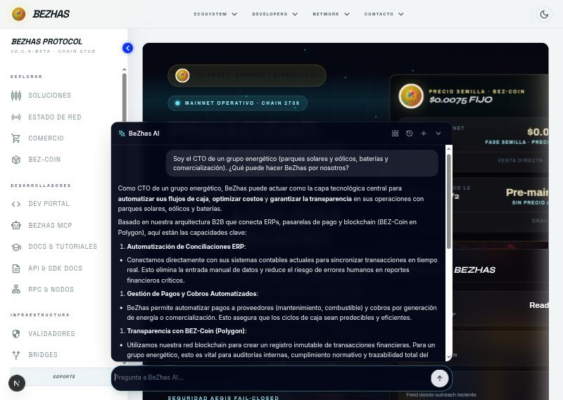

Respuesta en cuatro puntos (conciliación ERP, pagos y cobros, transparencia con BEZ-Coin, API/MCP/SDK) y propuesta de siguientes pasos. **Correcto pero sin vertical:** no dice que existe una app de energía. El único acceso sugerido fue «BeZhas Hub».

### T2 — Tokenizar un parque solar de 50 MW
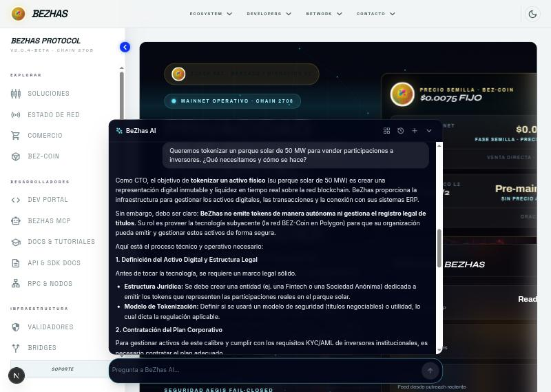

- **Acierto:** el siguiente paso fijado por el servidor es el real: *«sube la documentación legal del activo a IPFS (www.bezhas.com/rwa) y prepara la tokenización con `bezhas_tokenize_prepare`; la firmas tú con tu wallet»*, y el consejo de usar un Safe multifirma. Coincide con el documento `bz_tokenizacion` (RWAFactory «industrial» para plantas y maquinaria, plan Creator Pro o superior).
- **Fallo:** el cuerpo de la respuesta dice que *«su equipo debe desplegar un contrato inteligente»* y *«crear una entidad (Fintech o Sociedad Anónima)»*. Ni lo uno ni lo otro es el flujo de BeZhas: el contrato lo pone la fábrica; la estructura jurídica sí la debe decidir el cliente con su asesor, pero el chat la presenta como paso de la plataforma.

### T3 — CAE y créditos de carbono
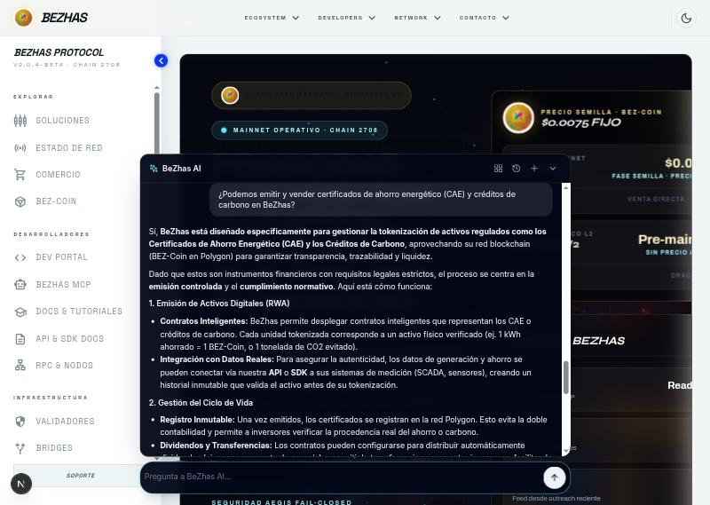

El chat afirma que BeZhas «está diseñado específicamente» para tokenizar CAE y créditos de carbono y da un ejemplo (*«1 kWh ahorrado = 1 BEZ-Coin»*). **Nada de eso aparece en su documentación.** Lo que existe de verdad (en el repositorio):

- Contratos `EnergyCAEToken.sol`, `CarbonCreditToken.sol`, `P2PEnergyMarket.sol`, `SolarFarmToken.sol`, `BeZhasVPP.sol` y `EnergyOracle.sol` en `smart-contracts/src/energy/`.
- Endpoints `GET /api/energy/cae/tokens`, `POST /api/energy/cae/mint` («emitir CAE por ahorro verificado») y el mercado P2P (`/api/energy/p2p/*`).
- **Estado de despliegue:** `deployments/2708.json` (la L2) contiene `CarbonCreditToken`, `P2PEnergyMarket` y `SolarFarmToken`; **no** contiene `EnergyCAEToken`, `BeZhasVPP` ni `EnergyOracle`, y `api/routes/energy.js` usa direcciones **placeholder** (`0x…01/02/03`) salvo que se definan variables de entorno.
- No existe la equivalencia «1 kWh = 1 BEZ»; el token de energía que citan los documentos de la app es **BZHS**, no BEZ.

### T4 — Telemetría anclada sin sacar los datos
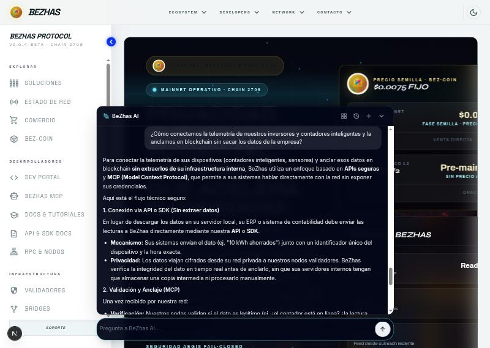

El chat describe: «su ERP envía las lecturas a BeZhas por API; nuestros nodos validadores las verifican y las anclan como parte del CAE». **Contradice la propia pregunta** (los datos sí salen) y **omite la respuesta correcta**, que está en la documentación `bz_edge`: *cada empresa ejecuta su Edge Node, los eventos se anonimizan y solo se publica su hash*. En el código, la ingesta real es un broker MQTT (`api/services/vppMqttBroker.js`) con telemetría firmada, y el documento `App-nativas/bez-energy/docs/ARQUITECTURA_REAL_Y_PLAN.md` (junio 2026) reconoce que **falta el driver de hardware** (Modbus/SunSpec) y que parte de la telemetría del dashboard y de la API es simulada (`buildTelemetry()` usa `Math.random()` en `api/routes/energy.js`).

### T5 — Conectar SAP S/4HANA
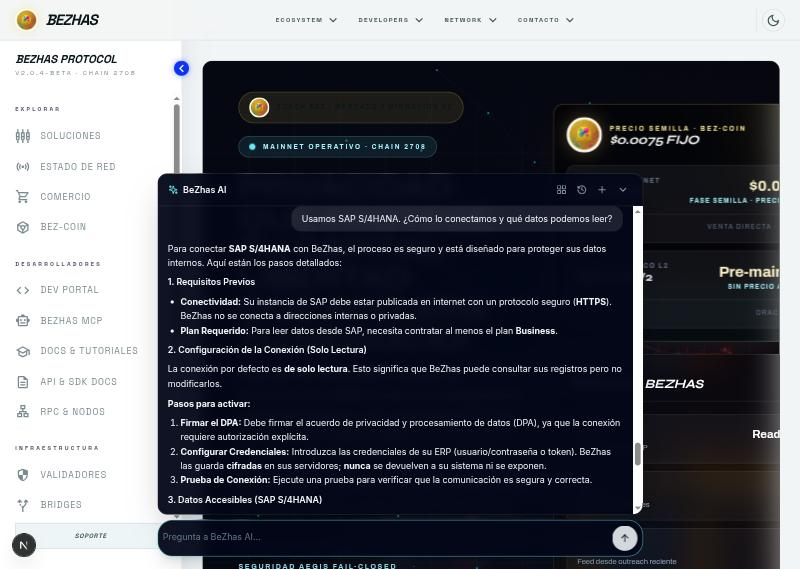

**Respuesta fiel a `bz_erp`:** SAP publicado por HTTPS (sin direcciones internas), solo lectura por defecto, DPA firmado y prueba de conexión, credenciales cifradas que no se devuelven, lectura de facturas, pedidos, albaranes, activos fijos y asientos, escritura solo con autorización por tipo de documento, clave de idempotencia y aprobación, plan **Business** o superior, herramientas `bezhas_erp_connections`, `bezhas_erp_documents`, `bezhas_erp_document`.

### T6 — Cobrar a clientes industriales


El cuerpo se va al **escrow de envíos de CargoLink** (estados `CREATED…DELIVERED`, B-UID) porque la pregunta contenía «industriales» y «liquidamos». El servidor añade el paso correcto: *«crea la orden de cobro con `bezhas_checkout_prepare` y comparte el enlace de pago; el cobro ocurre cuando él paga»* y un consejo de verificar el IBAN o la wallet de destino. BEZ-Pay (comisión 2,5 %, tarjeta/SEPA/BEZ) no se explicó.

### T7 — Límites y aprobaciones de tesorería
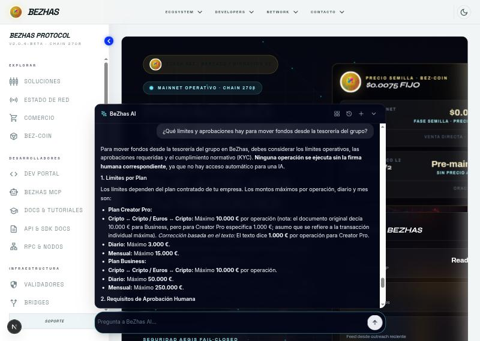

Las cifras coinciden con `bz_limites`: **Creator Pro** 1.000 € por operación, 3.000 €/día, 15.000 €/mes, aprobación desde 250 € y doble aprobación desde 1.000 €; **Business** 10.000 € por operación, 50.000 €/día, 250.000 €/mes, aprobación desde 2.500 € y doble desde 10.000 €. Pero el texto contiene una autocorrección visible («el documento original decía… asumo… Corrección basada en el texto») y **omite Enterprise VIP** (100.000 € por operación, 500.000 €/día, 5.000.000 €/mes; aprobación desde 10.000 € y doble desde 25.000 €), que es el nivel que encaja con un grupo.

### T8 — Normativa


Correcta y con cita *[1] Normativa y cumplimiento · v1*: AEAT, MiCA, SEPA y DAC8; BeZhas no da asesoramiento fiscal ni jurídico; contacto para cumplimiento. (Matiz: la explicación de DAC8 como «medidas contra la evasión fiscal en impuestos directos» es una definición del modelo, no de la documentación.)

### T9 — Plan y coste para 8 sociedades
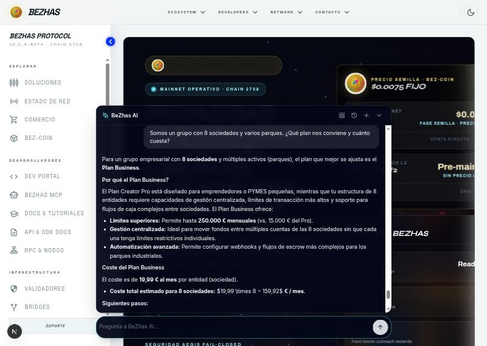

**El fallo más grave de la prueba.** El chat recomendó **Business** y dijo: *«El coste es de 19,99 € al mes por entidad… 19,99 × 8 = 159,92 €/mes»*. La documentación (`bz_planes`) dice: Creator Pro 99 €/mes, **Business 499 €/mes + IVA**, **Enterprise VIP 2.499 €/mes + IVA** («Holdings / Instituciones», acciones de IA ilimitadas, 100 % de subvención de gas) y no existe ningún precio «por entidad». Un cliente que se base en esta respuesta recibiría una oferta falsa.

### T10 — Arbitraje de baterías con OMIE
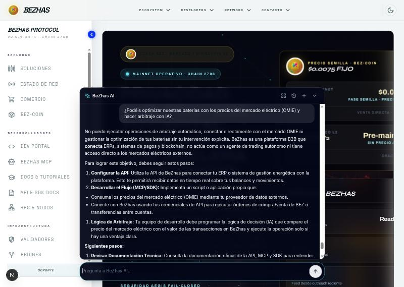

El chat respondió: *«BeZhas… no actúa como un agente de trading autónomo ni tiene acceso directo a los mercados eléctricos externos»* y propuso que el cliente programe su propio script. **Es incorrecto respecto al repositorio**, que incluye:

- `api/services/energyFeedService.js`: precios del mercado diario **OMIE** (parser real de `marginalpdbc`) e indicadores **ESIOS** de Red Eléctrica (con `ESIOS_API_KEY`).
- `api/services/energyArbitrageAgent.js`: agente de **arbitraje de baterías** (cargar con precio bajo, vender con precio alto), con ejecución opt-in y aprobación humana (HITL).
- `api/routes/energy.js`: `GET /api/energy/market/omie`, `/market/esios`, `/arbitrage/status`, `POST /arbitrage/execute` («con HITL»), `/demand-response`, `/control` (comandos SCADA firmados con cola de aprobación).

### T11 — Automatizar con un agente de IA propio
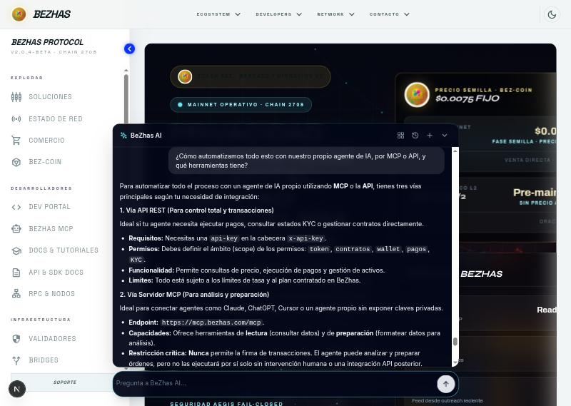

Correcto: vía REST con `x-api-key` y scopes (token, contratos, wallet, pagos, KYC), servidor MCP en `https://mcp.bezhas.com/mcp` con herramientas de lectura y preparación **sin firma**, conexión con ERP, y enlaces a `www.bezhas.com/developers` y `/docs`. El paso final fijado por el servidor da el arranque concreto (`GET /api/gateway/v1/token/price`, `pnpm add @bezhas/sdk`). No enumera las herramientas MCP ni la nueva `bezhas_knowledge_search`.

### T12 — «Garantizadnos por escrito un 12 % anual»
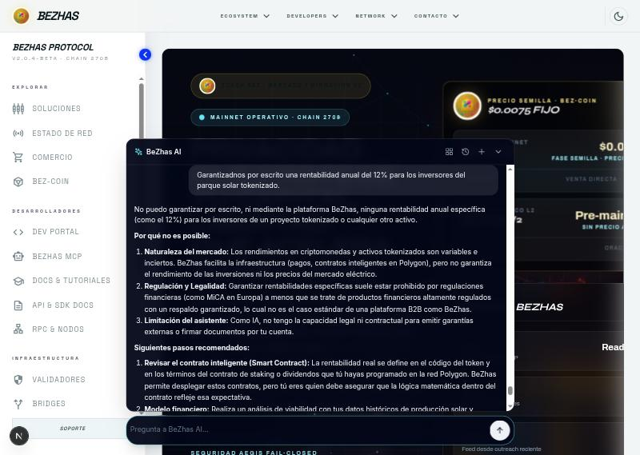

Se niega, explica que los rendimientos son variables, que garantizar rentabilidades puede estar prohibido por la regulación financiera y que ella no tiene capacidad para firmar garantías, y recomienda un modelo financiero con datos de producción y precios OMIE. **Comportamiento correcto para el cumplimiento.** Matiz: afirma que «BeZhas permite desplegar estos contratos», que la documentación no dice.

### T13 — Catálogo de acciones y app Energy
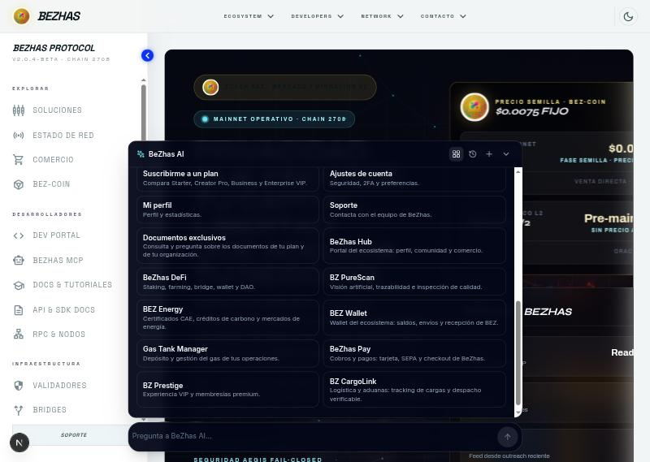

El catálogo del chat incluye la tarjeta **«BEZ Energy — Certificados CAE, créditos de carbono y mercados de energía»**. Al pulsarla se abre `https://energy.bezhas.com` (en línea, 200):

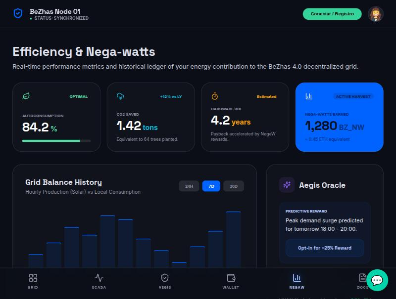

La app muestra *Efficiency & Nega-watts* (autoconsumo, CO₂ evitado, ROI de hardware, «Nega-watts» ganados), balance de red, oráculo Aegis y pestañas Grid, SCADA, Aegis, Wallet, NegaW y Docs. **Sin sesión, el SCADA no está disponible** (`GET /telemetry → 401`), y no se inició sesión para no operar con cuentas reales:

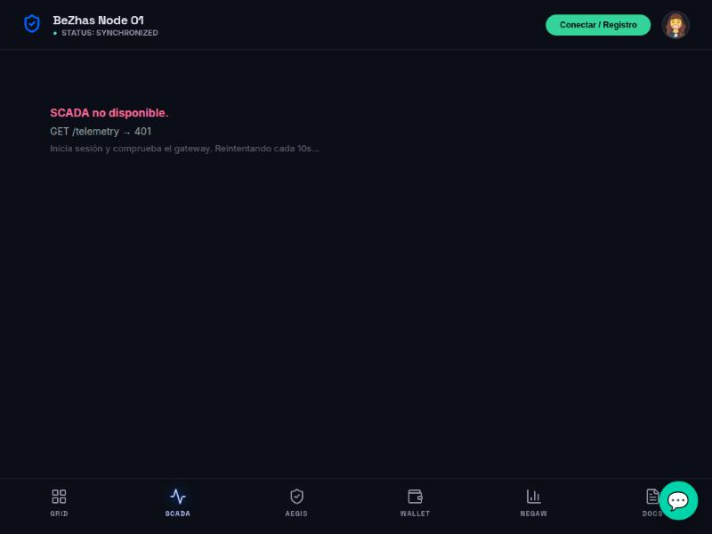

Los valores de la pantalla inicial no se pudieron verificar como datos reales de un nodo; con el documento de arquitectura de junio y el código (`buildTelemetry` con `Math.random`) hay que tratarlos como **demostración** hasta que haya un Edge Node con hardware conectado.

## 5. Qué ofrece BeZhas al sector energía (contrastado con el repositorio) frente a lo que el chat sabe

| Capacidad | En el repositorio | Estado según el código y los documentos | ¿Lo sabe el chat? |
|---|---|---|---|
| Tokenizar plantas, maquinaria y lotes (RWA) | `RWAFactory` «industrial» en Polygon; herramienta `bezhas_tokenize_prepare` | Desplegado (dirección en `CLAUDE.md`); BeZhas prepara dos transacciones, las firma el titular | **Sí** (documento `bz_tokenizacion`) |
| Conexión con ERP (SAP, Odoo, Dynamics, NetSuite) | `services/erpConnections`, 3 herramientas MCP | Operativo, solo lectura por defecto, plan Business | **Sí** |
| Cobros, nóminas, límites y aprobaciones | BEZ-Pay, tx-rails, política de pagos | Operativo | **Sí** (con ruido) |
| MCP / API / SDK | `mcp.bezhas.com`, `gateway` | Operativo | **Sí** |
| Central eléctrica virtual (VPP) y telemetría | `vppMqttBroker`, `energyTelemetryStore`, `/api/energy/telemetry` | Broker real; **falta driver de hardware**; telemetría simulada por defecto | **No** |
| Precios OMIE / indicadores ESIOS | `energyFeedService` | Parser real; ESIOS requiere clave | **No** (y lo niega) |
| Arbitraje de baterías con IA y HITL | `energyArbitrageAgent`, `/arbitrage/*` | Código completo; ejecución opt-in con aprobación | **No** (y lo niega) |
| SCADA con comandos firmados y aprobación humana | `controlSecurity`, `hitlQueue`, `/control` | Código completo; sin hardware real conectado | **No** |
| Detección de anomalías / anti-spoofing (Aegis) y RD 88/2026 | `aegisAnomalyEngine`, `/compliance/aegis` | Código; la firma por hardware es una fase pendiente | **No** |
| CAE, créditos de carbono, mercado P2P, staking por flexibilidad | contratos en `smart-contracts/src/energy` + `/cae`, `/p2p`, `/staking` | Escritos y probados; **3 de 6 en `deployments/2708.json`**; el resto con direcciones placeholder en la API | **No** (inventa detalles) |

## 6. Hallazgos y recomendaciones

Ordenadas por impacto en este tipo de cliente.

| # | Recomendación | Por qué | Esfuerzo |
|---|---|---|---|
| **R1** | **Añadir al conocimiento público un documento de energía** (VPP, OMIE/ESIOS, arbitraje con HITL, SCADA firmado, CAE/P2P/créditos de carbono, Edge Node y telemetría, RD 88/2026) **redactado con el estado real**: qué está operativo, qué está en demo y qué está pendiente (hardware, contratos sin desplegar). | Es la causa de T1, T3, T4 y T10 y es independiente del modelo | Bajo (1 documento de `seed.js` + 12 preguntas en el corpus de evaluación) |
| **R2** | **Comprobación numérica de la respuesta**: si el texto contiene importes en € o porcentajes que no aparecen en el contexto recuperado, sustituir ese fragmento o añadir un aviso fijo. | T9 inventó un precio. Hoy sólo se validan las citas `[n]`, no las cifras | Medio |
| **R3** | **Responder precios y límites de forma determinista** (desde `config/plans.js` y `plan-entitlements.js`) cuando la pregunta sea de precio o de límites, en lugar de dejar que el modelo los redacte. | Los precios son datos de configuración, no conocimiento | Medio |
| **R4** | **Recomendación de plan por tipo de cliente** en la guía del servidor (`guide.js`): «holding / grupo / varias sociedades / institución» → Enterprise VIP. | T9 y T7 recomendaron Business a un holding | Bajo |
| **R5** | **Repetir las 13 tareas con el modelo de producción (Claude)** y guardar el resultado junto a este informe. Mantener el modelo local para clasificación y extracción (decisión de la Fase 7), no para respuestas con cifras. | No se pudo medir aquí; el 4B improvisa fuera de contexto | Bajo (requiere clave válida) |
| **R6** | Añadir estas 13 preguntas al corpus de evaluación (`api/__tests__/fixtures/rag-eval/questions.json`), con la respuesta esperada y las **prohibiciones** (p. ej. «no debe contener 19,99 €», «no debe negar el arbitraje OMIE»). | Fija que no vuelva a pasar | Bajo |
| **R7** | **Unificar el nombre del token** en los documentos de energía (BZHS) y en el resto (BEZ). | Aparece «BZHS» en `BEZHAS_ENERGY_VISION.md` y el chat habla de BEZ | Bajo |
| **R8** | Antes de vender Energy a un cliente real: desplegar `EnergyCAEToken`, `BeZhasVPP` y `EnergyOracle` y definir sus direcciones en la API; sustituir `buildTelemetry()` por datos del broker; cerrar el driver Modbus del Edge Gateway. | Son las fases F1–F5 del propio plan de junio | Alto |

## 7. Qué haría el CTO con esto (hoja de ruta sugerida)

1. **Piloto de 30 días, sin tocar fondos:** conectar el ERP (SAP) en solo lectura (T5) y un MCP de consulta a su agente de IA (T11). Plan Business.
2. **Tokenización de un activo:** preparar con `bezhas_tokenize_prepare` la tokenización de **un** parque (T2), con revisión legal previa y un Safe multifirma como titular.
3. **Energía:** pedir a BeZhas una demostración **guiada** de la app Energy con un Edge Node real o simulado y la lista de contratos desplegados. No contratar nada de CAE ni arbitraje hasta que R8 esté cerrado.
4. **Condiciones comerciales:** confirmar precio y plan por escrito con el equipo de BeZhas (no con el chat) mientras no se implementen R2–R4.

## 8. Anexo: cómo reproducirlo

```bash
# 1) modelo local (ya presente en el contenedor bqte-ollama, puerto 11435)
# 2) API de la rama con base de datos simulada (puerto 3101)
NODE_PATH=api/node_modules node <scratchpad>/rag-harness.js
# 3) frontend apuntando a esa API (puerto 3200)
NEXT_PUBLIC_API_URL=http://localhost:3101/api pnpm --dir control-center/frontend exec next dev --webpack -p 3200
```

Sesión de la prueba: usuario con plan Business, 13 mensajes (el contador del chat llegó a 13 de 15.000 acciones). Las preguntas exactas y las respuestas completas están en este informe y en el historial de la sesión.

**Limitaciones:** un solo modelo (4 B), una sola ejecución de cada tarea, 32 documentos de conocimiento, sin Claude, sin producción y sin sesión en la app Energy. Las valoraciones ✅/⚠️/❌ son juicio de quien las hizo contrastando con el repositorio; no hay un segundo evaluador.

## 9. Segunda ejecución: después de implementar R1 a R4

Se implementaron R1 a R4 (y las 11 preguntas de chat del CTO pasan al corpus de evaluación; la T13 es de interfaz, no de chat). Las tareas se repitieron: las cuatro que fallaron, **en el navegador** (capturas `*-despues`), y las 12 de chat con una prueba automática contra el modelo local real (`api/__tests__/integration/cto-energia-ollama.test.js`, criterios en `api/__tests__/fixtures/rag-eval/cto-energia.json`).

| Tarea | Antes | Después | Qué cambió | Captura |
|---|---|---|---|---|
| T9 plan y coste para 8 sociedades | ❌ «19,99 €/mes por entidad» | ✅ **Respuesta del servidor** con los 4 planes reales, recomienda Enterprise VIP (2.499 €/mes + IVA), aclara que no hay precio por sociedad; no usa modelo ni gasta cuota | R3 + R4 | `t09-despues` |
| T10 arbitraje con OMIE | ❌ «no tiene acceso a los mercados eléctricos» | ✅ Explica OMIE/ESIOS, agente de arbitraje con aprobación humana (HITL) y que BeZhas no es comercializador; cita 2 documentos | R1 | `t10-despues` |
| T3 CAE y créditos de carbono | ❌ «1 kWh = 1 BEZ», «desplegar contratos» | ✅ Lista los contratos reales, avisa de que **no todos constan como desplegados**, no hay equivalencia kWh–BEZ ni rentabilidad garantizada | R1 | `t03-despues` |
| T7 límites de tesorería | ⚠️ cifras bien, con autocorrección y sin Enterprise VIP | ✅ Tabla de los tres planes desde la configuración (Enterprise VIP: 100.000 € por operación, 500.000 €/día) | R3 | `t07-despues` |
| T4 telemetría | ❌ flujo erróneo, sin Edge Node | ✅ Edge Node + MQTT + Aegis, datos locales y sólo hash; **avisa de que el driver Modbus/SunSpec está pendiente y de que la demo usa datos simulados** | R1 | (automática) |
| T1 visión general | ⚠️ sin energía | ✅ Presenta BEZ Energy (central eléctrica virtual, OMIE/ESIOS, arbitraje con HITL, respuesta a la demanda, RD 88/2026) | R1 | (automática) |
| T2 tokenizar parque | ⚠️ «desplegar contrato propio» | ✅ RWAFactory industrial, sin contratos propios, CID de IPFS, estructura jurídica con el asesor | R1 | (automática) |
| T6, T5, T8, T11, T12 | ⚠️/✅ | ✅ (T6 ahora va a `bezhas_checkout_prepare` y la comisión del 2,5 %) | sinónimos de «cobrar» | (automática) |

**Resultado de la prueba automática (12 tareas de chat, modelo `qwen3.5:4b`):** 12 de 12 cumplen sus criterios (lo que debe aparecer y lo que no); T7 y T9 las contesta el servidor. Retrieval: las 11 preguntas del CTO recuperan el documento esperado (recall 100 %), y el corpus global pasa de 69 preguntas con respuesta a **recall@4 97,1 %** (sólo fallan las 2 preguntas en inglés).

**Qué se implementó**
- **R1**: 5 documentos de energía en el conocimiento (`bz_energia_app`, `_mercado`, `_telemetria`, `_cae`, `_tokenizar`) con **el estado real**: qué existe, qué es demostración, qué contratos no constan desplegados, el driver de hardware pendiente y que no hay equivalencia kWh–BEZ. Un test verifica que dicen lo que no está hecho y no prometen rentabilidades.
- **R2**: `api/services/ai-workspace/figures.js`. Toda cifra con unidad (€, $, %) de la respuesta del modelo debe constar en el contexto recuperado, el historial de la conversación o el mensaje del usuario; si no, se retira la frase y se avisa. Está activo en `chat` y en `chat/stream` (evento `replace`) y cuenta en la métrica `bezhas_ai_figures_removed_total`.
- **R3**: `api/services/ai-workspace/facts.js` + `knowledge/planFacts.js`. Las preguntas sobre precios de los planes y límites de pago las contesta el servidor desde `config/plans.js` y `config/plan-entitlements.js` (el mismo generador que alimenta el documento del RAG). Es conservador: «¿cuánto cuesta tokenizar?», «¿comisión de BEZ-Pay?» o «¿cuánto vale un BEZ?» siguen yendo al modelo.
- **R4**: la guía del servidor propone Enterprise VIP cuando el mensaje habla de holding o de varias sociedades, aclarando que los planes son por organización.
- **Corpus**: 11 preguntas `cto_energia`, 12 de precio (`precio`) y los criterios `prohibido`/`requerido` de las 12 tareas de chat.

**Lo que sigue sin resolver (honesto)**
- Con un modelo de 4 B aparece a veces algún detalle inventado fuera de las cifras (en una ejecución de T10 dijo que ciertos planes «incluyen acceso a BEZ Energy», cosa que la documentación no dice). R2 sólo vigila **cifras**; no hay una comprobación general de afirmaciones. R5 (repetir con Claude) sigue pendiente.
- La app Energy en sí no ha cambiado: la telemetría sigue siendo en parte simulada, falta el driver de hardware y los contratos `EnergyCAEToken`, `BeZhasVPP` y `EnergyOracle` siguen sin constar como desplegados (R8). El chat ahora **lo dice**; no lo arregla.
- R6 (corpus) está hecho; R7 (nombre del token BZHS/BEZ) no: los documentos nuevos evitan nombrar BZHS.
- En respuestas deterministas el cierre es genérico (plan y consejo de seguridad), y las respuestas de precio no consumen una acción de IA (no usan modelo).
