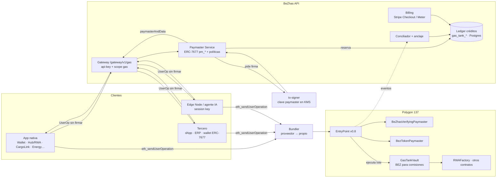

# BZ Gas Tank: investigación y plan de desarrollo

> **Fecha:** 2026-10-24 · **Estado de partida:** prototipo (≈ 25-30 %) · **Ruta:** `App-nativas/gas-tank-manager/`
> **Objetivo:** que cualquier empresa, app nativa o integrador externo pueda **ejecutar operaciones on-chain en BeZhas (tokenizar, anclar, transferir, firmar) sin que sus usuarios tengan POL ni BEZ**, pagando de un depósito prepago gestionado, con límites, auditoría y factura.

---

## 0. Resumen ejecutivo

1. **Qué es un Gas Tank bien hecho en 2026:** no es "un saldo con un medidor". Es un **motor de abstracción de comisiones** formado por cuatro piezas:
   - un **depósito prepago** por organización;
   - un **motor de políticas** que decide quién puede gastar, en qué y hasta cuánto;
   - un **paymaster ERC-4337** que paga el gas en la cadena;
   - un **ledger auditable** que convierte cada operación en un cargo facturable.
2. **Tokenización = gas + comisión de protocolo.** Tokenizar un activo en `RWAFactory` cuesta el gas en POL **más 100 BEZ** de `tokenizationFee` (que se cobra con `transferFrom(msg.sender…)`). Un Gas Tank que sólo pague el gas no sirve para tokenizar: tiene que cubrir **las dos cosas**.
3. **Decisión de arquitectura recomendada:**
   - **Saldo en créditos EUR** del ledger unificado (1 crédito = 0,001 €, el mismo de `UNIFIED_BEZ_BILLING` y OPERANT), no BEZ en manos del cliente.
   - Gas pagado por un **Verifying Paymaster propio (EntryPoint v0.8) en Polygon**, firmado desde el `tx-signer` con la clave en KMS.
   - Las comisiones en BEZ se pagan desde una **bóveda (`GasTankVault`)** de BeZhas dentro de la misma UserOperation.
   - El BEZ actúa como respaldo on-chain y como opción de pago directa ("paga gas con BEZ"), no como requisito.
4. **Lo que ya existe y se reutiliza:**
   - `Paymaster.sol` (18 tests en verde, pero es un libro de cuentas, no un paymaster 4337);
   - `SmartWallet`/`SmartWalletFactory`;
   - `tx-signer` aislado con KMS;
   - Gateway con api-keys, scopes y `app_registry`;
   - facturación por uso con Stripe Meter (`usageBilling.js`);
   - ledger de créditos unificado;
   - anclaje de auditoría (patrón `operantAnchor`);
   - `_shared/` y `@bezhas/platform-sdk` en todas las SubApps.
5. **Fase 0 urgente:** el `gasMonitor` que hoy corre en producción cada 60 s mezcla unidades (lee POL y lo llama BEZ) y hace transferencias nativas automáticas a la Hot Wallet. Hay que desactivarlo antes de nada (ver §8).

---

## 1. Investigación: cómo se construye un Gas Tank hoy

### 1.1 Estándares que importan

| Estándar | Qué aporta | Estado | Uso en BeZhas |
|---|---|---|---|
| **ERC-4337 (EntryPoint v0.8)** | UserOperations, bundlers, paymasters. En v0.8: hash EIP-712 de la UserOp, soporte nativo de autorizaciones EIP-7702, `Simple7702Account` auditada y correcciones de contabilidad de gas en `postOp`. | Producción | Columna vertebral del patrocinio |
| **EIP-7702** | Una EOA (MetaMask, Ledger…) delega temporalmente en código de smart account **sin cambiar de dirección**. | Activo en Polygon PoS desde el hardfork **Bhilai** (julio 2025) | Usuarios con wallet propia patrocinados sin migrar fondos |
| **ERC-7677** | Capacidad `paymasterService`: la dApp pasa al wallet la URL de un servicio paymaster (`pm_getPaymasterStubData`, `pm_getPaymasterData`). | En revisión. Ya lo implementan Coinbase Smart Wallet, Ambire, Reown AppKit, thirdweb, Openfort… | Integración con wallets y dApps de terceros |
| **ERC-5792** | `wallet_sendCalls` (lotes atómicos) + `wallet_getCapabilities`. | Ampliamente soportado | Aprobar + tokenizar en un solo clic |
| **ERC-7562** | Reglas de validación que los bundlers imponen a paymasters (almacenamiento, opcodes, reputación). | Obligatorio en la práctica | Diseño del contrato paymaster |
| **ERC-7579** | Módulos estándar para smart accounts (session keys, validadores). | Producción (Kernel, Safe7579, Nexus) | Session keys para Edge Nodes y agentes IA |

### 1.2 Tipos de paymaster

| Tipo | Quién paga | Cuándo usarlo |
|---|---|---|
| **Verifying (sponsoring) paymaster** | El operador (BeZhas) adelanta el gas y lo carga al tanque de la empresa off-chain. Un servidor de políticas firma cada UserOp aprobada (`validUntil`/`validAfter`). | **Modo por defecto B2B**: la empresa paga en euros y sus usuarios no ven nada |
| **ERC-20 / Token paymaster** | El usuario paga el gas en un token (aquí BEZ). Se cobra el máximo en la validación y se devuelve el exceso en `postOp` (patrón de `pimlicolabs/singleton-paymaster`). | B2C y holders de BEZ: es utilidad real del token |
| **Deposit paymaster on-chain** | Cada empresa deposita en el contrato y el paymaster descuenta on-chain. | Clientes que exigen custodia y verificación on-chain del saldo (lo que intenta hacer hoy `Paymaster.sol`) |
| **Relayer / meta-transacción** | Un relayer firma y envía con su propia EOA. | Operaciones de sistema y backends (Edge Nodes, anclajes) y contratos ya desplegados no compatibles con 4337 |

### 1.3 Cómo lo hacen los proveedores de referencia

- **Alchemy Gas Manager:**
  - políticas en panel (topes de gasto, listas de permitidos, fechas);
  - política "Pay gas with any token" con dirección receptora, tokens aceptados y modo *After* (aprobación en el mismo lote) o *Before*;
  - avisan de que los topes se pueden superar brevemente con mucho tráfico y de que, si falla la transferencia ERC-20 en el modo *After*, el gas lo paga igualmente el operador.
- **Pimlico:**
  - políticas de patrocinio con límites de tasa, listas de permitidos y topes por dApp;
  - su paymaster ERC-20 antiguo está archivado y el vigente es `singleton-paymaster`.
- **Lecciones para BeZhas:**
  1. Las políticas tienen que aplicarse **antes de firmar**, no después.
  2. Hay que **reservar** saldo en el momento de firmar y liquidarlo con el coste real (`postOp`/recibo).
  3. El operador asume el riesgo de las operaciones que revierten, así que cada operación necesita su propio tope.
  4. Hay que vigilar el depósito del paymaster en el EntryPoint, que es dinero real en POL.

### 1.4 Funcionalidad de un Gas Tank completo (benchmark)

**Para la empresa (admin del tenant)**
- Saldo en € y su equivalente estimado en operaciones, previsión de agotamiento ("te quedan ~9 días al ritmo actual").
- Recarga: tarjeta (Stripe Checkout), SEPA (transferencia con referencia), BEZ (depósito on-chain), y **auto-recarga** off-session con umbral e importe.
- Presupuestos por **app, departamento, proyecto, usuario** y por **tipo de operación** (p. ej. "máx. 20 tokenizaciones/mes").
- Políticas: contratos y funciones permitidos, límites diarios/mensuales/por operación, horarios, requisito de KYC para operaciones reguladas (tokenización, transferencias de RWA).
- Miembros y roles (owner, finanzas, operador, auditor), api-keys por app, *session keys* para máquinas.
- Historial con hash de transacción, app, usuario, operación, gas real, comisión, € cargados; exportación CSV/XLSX; facturas PDF con IVA.
- Alertas (correo, Telegram, webhook): saldo bajo, recarga fallida, pico anómalo, operación rechazada por política.
- Simulador de costes: "¿cuánto me cuesta tokenizar 50 activos?".

**Para el usuario final**
- Invisible: firma (passkey, wallet o SSO) y la operación sale. Distintivo "Comisiones patrocinadas por *Empresa X*".
- Si su empresa no patrocina esa operación: opción de pagar con BEZ (token paymaster) o con su propio POL.
- Historial personal de operaciones patrocinadas.

**Para el superadmin de BeZhas**
- Tesorería del paymaster: depósito en EntryPoint (POL), saldo de la `GasTankVault` (BEZ), saldo del relayer. Alertas y rellenado **con aprobación** (nunca automático desde la API).
- Todas las organizaciones: consumo, margen, deuda, estado (activa, suspendida, agotada).
- Políticas globales y **kill-switch** (pausar el patrocinio global o de una organización, app o contrato).
- Precio: oráculo POL/EUR y BEZ/EUR, markup, comisiones de protocolo, simulación de márgenes.
- Conciliación diaria: ledger off-chain frente a eventos on-chain frente a Stripe, con anclaje del resumen.
- Salud: bundler, RPC, tasa de rechazo, latencia de inclusión, operaciones revertidas pagadas.
- Antifraude: anomalías por organización, bloqueo de direcciones y reputación de cuentas.

---

## 2. Arquitectura propuesta para BeZhas

### 2.1 Vista general



### 2.2 Contratos (Foundry, `smart-contracts/src/gas/`)

| Contrato | Responsabilidad | Base |
|---|---|---|
| `BeZhasVerifyingPaymaster` | `validatePaymasterUserOp`: verifica la firma EIP-712 del Paymaster Service (organización, app, `validUntil`, tope de gas, hash de la política). `postOp`: emite `GasCharged(orgId, sender, actualGasCost, opHash)`. | `BasePaymaster` de eth-infinitism v0.8 |
| `BezTokenPaymaster` | El usuario paga en BEZ: cobra el máximo en la validación, devuelve el exceso en `postOp`, precio desde un oráculo con TWAP y límite de desviación. | Patrón `singleton-paymaster` (ERC-20 mode) |
| `GasTankVault` | Guarda BEZ de BeZhas para **comisiones de protocolo** (tokenización 100 BEZ, etc.). `pullProtocolFee(orgId, target, amount, sig)` envía el BEZ justo a la smart account del usuario dentro del lote; sólo con firma del Paymaster Service y para pares `(target, selector)` en lista blanca. Opcional: depósitos on-chain de BEZ por organización para clientes que quieren custodia verificable. | Evolución de `Paymaster.sol` (reutiliza tests de límites, usuarios, contratos permitidos, pausa) |
| `BezPriceOracle` | Precio BEZ/POL (TWAP del pool QuickSwap + límites). Lo usan `BezTokenPaymaster` y el motor de precios. | Nuevo |
| Cuentas | `Simple7702Account` (EOAs vía 7702) + smart account ERC-7579 (Kernel/Nexus) para usuarios nuevos con passkey. El `SmartWallet` propio se puede mantener si se le añade `validateUserOp`. | Auditadas, no reinventar |

**Flujo de tokenización patrocinada (un solo clic, un solo lote atómico):**

```
UserOp.callData = executeBatch([
  GasTankVault.pullProtocolFee(orgId, RWAFactory, 100 BEZ, sigPMS),  // la Vault envía 100 BEZ a la smart account
  BEZ.approve(RWAFactory, 100 BEZ),
  RWAFactory.tokenizeAsset(...)                                       // transferFrom(msg.sender) ya encuentra los 100 BEZ
])
paymasterAndData = BeZhasVerifyingPaymaster + firma(orgId, appId, maxCost, validUntil)
```

Así se usa la `RWAFactory` **ya desplegada sin tocarla**. El ledger carga a la organización: gas real × POL/EUR + 100 BEZ × BEZ/EUR + markup.

### 2.3 Backend (`api/`)

| Módulo | Contenido |
|---|---|
| `api/config/gas-tank.js` | Fuente de verdad de precios, topes y operaciones conocidas (`tokenizeAsset`, `anchor`, `transfer`…), como `operant-services.js`. Tests que fallan si el margen baja de un mínimo. |
| `api/services/gasTank/ledger.js` | `reserve(orgId, maxCostCredits, opHash)` → `settle(opHash, actualCost)` → `release(opHash)`. Transaccional (`SELECT … FOR UPDATE`), idempotente por `opHash`. Reutiliza el ledger de créditos unificado como **bucket `gas`** del mismo saldo. |
| `api/services/gasTank/policy.js` | Evalúa: organización activa, app autorizada (`app_registry`), contrato y selector permitidos, límites por usuario/app/día/mes/operación, KYC, kill-switches. Devuelve `policyHash`. |
| `api/services/gasTank/paymasterService.js` | `pm_getPaymasterStubData` y `pm_getPaymasterData` (ERC-7677). Simula la UserOp (`eth_estimateUserOperationGas` + `debug_traceCall` opcional), reserva y pide firma al `tx-signer`. |
| `api/services/gasTank/reconciler.js` | Escucha `GasCharged`/`UserOperationEvent` del EntryPoint y liquida las reservas. Las que caducan se liberan. Cierre diario con anclaje (patrón `operantAnchor`). |
| `api/services/gasTank/treasuryWatch.js` | **Sustituye al `gasMonitor` actual.** Sólo **mide y alerta** (depósito del EntryPoint, Vault, relayer). Nunca transfiere. El rellenado es una intención aprobada que firma el `tx-signer`. |
| `api/routes/gas.js` | Ver §4.1. |
| `tx-signer` | Nueva intención `paymaster.sign` con topes propios: coste máximo por operación, volumen máximo por hora, lista de paymasters válidos. Vuelve a verificar el `policyHash`. |

**Modelo de datos (migración nueva):**

```sql
gas_tank_accounts   (org_id PK, status, auto_recharge_enabled, threshold_credits, recharge_credits,
                     stripe_customer_id, monthly_cap_credits, created_at, updated_at)
gas_tank_policies   (id, org_id, scope_type /*org|app|user|department*/, scope_id,
                     allowed_targets jsonb /*[{address,selectors[]}]*/, op_types text[],
                     per_op_cap, daily_cap, monthly_cap, require_kyc bool, active, version)
gas_tank_reservations (op_hash PK, org_id, app_id, sender, max_cost_credits, policy_hash,
                     valid_until, status /*reserved|settled|released|failed*/, created_at)
gas_tank_ledger     (id, org_id, kind /*recharge|charge|refund|adjustment|bonus*/, credits,
                     op_hash, tx_hash, chain_id, gas_used, gas_price_wei, protocol_fee_bez,
                     pol_eur, bez_eur, app_id, user_id, op_type, stripe_ref, created_at)
gas_tank_alerts     (id, org_id, type, channel, threshold, last_fired_at)
```

> **No reutilizar `gas_balances`/`enterprises.gas_tank_address`**: miden saldo nativo de una dirección, que es justo el modelo erróneo del `gasMonitor`. Hay que migrarlos y retirarlos en la fase 1.

### 2.4 Precio

Mismo principio que OPERANT: **coste real × margen**, con todo calculado en créditos.

```
cargo_creditos = ceil( (gas_used × gas_price × POL_EUR + fee_protocolo_BEZ × BEZ_EUR) × (1 + markup) / 0,001 € )
```

- `markup` por plan: Starter más alto; Business y Enterprise más bajos, y cubierto en parte por la cuota del módulo.
- Cada operación tiene un **coste máximo reservado**: se cobra el real y se libera el resto.
- Las operaciones revertidas se cobran igual (el gas se ha consumido), y el panel tiene que dejarlo claro.
- Holders y stakers de BEZ: descuento en el markup si pagan con BEZ o tienen BEZ en staking (utilidad del token sin convertirlo en requisito).
- La fórmula de precio va en `api/config/usage-pricing.js` y `gas-tank.js`, con tests de margen mínimo.

### 2.5 Regulación (MiCA · AEAT · DAC8)

- **Créditos en EUR, no BEZ, en el saldo del cliente:** se mantiene como **prepago de un servicio** (no reembolsable en cripto, no transferible). Si el cliente pudiera comprar BEZ con euros y retirarlos, BeZhas estaría prestando un servicio de criptoactivos (CASP) según MiCA. **Esto lo tiene que validar un asesor legal antes de la fase 2.**
- La opción "recargar con BEZ" es un **pago en especie** que BeZhas recibe: hay que registrarlo fiscalmente (valor en € en la fecha) y tenerlo en cuenta para DAC8.
- Facturas con IVA por cada recarga (no por cada operación). El consumo va en un anexo.
- Tokenización: la política exige KYC/KYB verificado de la organización antes de patrocinar `tokenizeAsset`.

---

## 3. Panel de la app (`gas.bezhas.com`)

### 3.1 Vistas del admin de la empresa

| Ruta | Contenido |
|---|---|
| `/` Dashboard | Saldo € (real), previsión de agotamiento, consumo de hoy/mes, top apps y operaciones, estado de la auto-recarga, alertas activas |
| `/recharge` | Paquetes y cantidad libre, Stripe Checkout (tarjeta/SEPA), depósito en BEZ, configuración de auto-recarga (umbral, importe, tope mensual, método guardado) |
| `/activity` | Ledger filtrable (app, usuario, operación, estado), enlace a Polygonscan, exportación CSV/XLSX |
| `/budgets` | Presupuestos por app, departamento o usuario y por tipo de operación |
| `/policies` | Contratos y funciones permitidos (con plantillas: "Tokenización RWA", "Trazabilidad CargoLink", "Pagos Wallet"), límites, horarios, requisito de KYC |
| `/members` | Roles (owner, finanzas, operador, auditor), invitaciones |
| `/apps` | Apps conectadas (nativas y de terceros), api-keys con scope `gas`, URL ERC-7677 por app, session keys de Edge Nodes |
| `/alerts` | Canales y umbrales |
| `/invoices` | Facturas PDF y resumen mensual |
| `/simulator` | "¿Cuánto cuesta X operaciones?" con precio en vivo |

### 3.2 Superadmin (en el Control Center, `control-center/frontend/app/dashboard/gas/`)

Tesorería (EntryPoint, Vault, relayer), organizaciones, precios y oráculos, kill-switch, conciliación, salud del bundler, márgenes, antifraude.

### 3.3 Experiencia del usuario final

Componente compartido `<SponsoredBadge org="…"/>` y hook `useSponsoredTx()` en `_shared/`: muestra "Patrocinado por…" o, si no hay patrocinio, ofrece "Pagar con BEZ".

---

## 4. Conexión con el ecosistema

### 4.1 API (Gateway, scope nuevo `gas`)

| Método | Ruta | Uso |
|---|---|---|
| `GET` | `/gateway/v1/gas/balance` | Saldo, reservas, previsión |
| `POST` | `/gateway/v1/gas/estimate` | Coste estimado de una operación o lote |
| `POST` | `/gateway/v1/gas/sponsor` | Patrocina una UserOp (devuelve `paymasterAndData`) |
| `POST` | `/gateway/v1/gas/relay` | Modo relayer para backends sin smart account (lo firma el `tx-signer`) |
| `GET` | `/gateway/v1/gas/activity` | Ledger paginado |
| `GET/PUT` | `/gateway/v1/gas/policies` | Políticas (rol admin) |
| `POST` | `/gateway/v1/gas/recharge/checkout` | Sesión de Stripe Checkout |
| `POST` | `/rpc/paymaster/:appKey` | **Endpoint ERC-7677** (`pm_getPaymasterStubData`, `pm_getPaymasterData`) para wallets y SDKs estándar (viem, permissionless, AppKit, thirdweb) |

**Webhooks** (con la cola existente `webhookRetryQueue`): `gas.low_balance`, `gas.recharged`, `gas.recharge_failed`, `gas.sponsored`, `gas.rejected`, `gas.daily_summary`.

**MCP:** herramientas `gas_balance`, `gas_estimate`, `gas_activity` (solo lectura) en `api/config/mcp-tools.js`. El patrocinio desde un agente IA sólo con session key y tope.

### 4.2 SDK compartido

- `@bezhas/platform-sdk/gas`: `createGasClient({ apiKey | jwt })` → `estimate()`, `sponsor(userOp)`, `sendSponsored({ calls, appId })`, `relay()`.
- `_shared/gas-tank-client.js` para las SubApps Vite. **Sustituye** al `blockchainService.js` actual de Gas Tank, que llama a funciones que no existen (`getGasBalance`, `isSponsoredOperation`).
- Integración con `viem`/`permissionless`: `paymaster: createPaymasterClient({ transport: http(<URL ERC-7677>) })`.

### 4.3 Apps nativas: qué patrocina cada una

| App | Operaciones patrocinadas | Quién paga | Modo |
|---|---|---|---|
| **Bezhas-Hub / RWA** | `tokenizeAsset` (gas + 100 BEZ), `verifyInvestor`, transferencias de fracciones | Empresa emisora | 4337 + Vault |
| **BEZ Wallet** | Transferencias BEZ, aprobaciones, recuperación social | Usuario (BEZ) o empresa | 4337 / token paymaster / 7702 |
| **BZ CargoLink** | Lotes de trazabilidad, `BeZhasLogisticsNFT` | Empresa logística | Relayer (lotes) → 4337 |
| **BZ PureScan / Vision** | Anclaje de certificados | Empresa cliente | Relayer |
| **BEZ Energy** | Liquidaciones VPP, certificados | Empresa energética | Relayer |
| **BZ Capital (DeFi)** | stake/unstake, farming | Usuario (BEZ) con descuento | Token paymaster |
| **BeZhas Pay** | Pagos con BEZ a comercios | Comercio (patrocina al comprador) | 4337 |
| **Edge Node Manager** | Lecturas de sensores, recompensas | Empresa dueña del nodo | Session key ERC-7579 + 4337 |
| **OPERANT / anclajes de sistema** | Anclaje de auditoría | Organización interna "BeZhas" (coste propio) | Relayer `tx-signer` |

Cada app se registra en `app_registry` con su `app_id`. La política de la organización decide qué `app_id` puede gastar de su tanque.

### 4.4 Terceros

- **dApps y wallets estándar:** la URL ERC-7677 basta para Coinbase Smart Wallet, Safe, Kernel, Ambire, AppKit…
- **ERPs y backends (SAP, Odoo, n8n, Make, Zapier):** usan `relay` con api-key. Se pueden publicar nodos y plantillas para n8n/Make.
- **Infraestructura externa:**
  - bundler: Pimlico, Alchemy o Candide al principio y uno propio (Alto, Rundler o Skandha, todos open source) cuando el volumen lo justifique;
  - RPC: varios proveedores con failover.
- **Reventa (white-label):** un integrador puede crear sub-tanques para sus clientes (organizaciones hijas con tope heredado).

---

## 5. Plan de desarrollo

> Las duraciones son orientativas para una persona a tiempo completo con ayuda de IA. Ninguna fase despliega contratos en mainnet ni mueve fondos sin **confirmación explícita de Yoel**.

### Fase 0: higiene y seguridad (1-2 días) 🔴 inmediata
- [ ] Desactivar la auto-recarga del `gasMonitor`: que sólo arranque con `GAS_MONITOR_AUTORECHARGE=true` y, mientras tanto, sólo mida y alerte. Corregir las unidades (saldo nativo = POL).
- [ ] Revisar en Cloud Logging si `[GasMonitor] Recarga exitosa` aparece en producción y, si aparece, con qué transacciones.
- [ ] Quitar `blockchainService.js` (código muerto con funciones inexistentes) y los datos inventados del frontend. En su lugar, estados vacíos honestos con "Beta privada".
- [ ] Sacar la dirección `0x5c9b...6fBAA` de `Recharge.jsx`.
- [ ] Actualizar CLAUDE.md: Polygon testnet = **Amoy (80002)** (Mumbai está retirada).

**Criterio de aceptación:** ningún proceso de la API transfiere fondos de forma autónoma y la app no muestra cifras ficticias.

### Fase 1: ledger, recarga y panel real, sin patrocinio on-chain (2-3 semanas)
- [ ] Migración `gas_tank_*` + `api/config/gas-tank.js` + tests de margen.
- [ ] `ledger.js` (reserva, liquidación, liberación, idempotencia) con tests unitarios y de concurrencia.
- [ ] Recarga por Stripe Checkout + webhook (`checkout.session.completed`) → `recharge` en el ledger. Auto-recarga off-session con `PaymentIntent` y tope mensual. Facturas.
- [ ] Rutas `/gateway/v1/gas/{balance,activity,estimate,recharge/checkout}` + scope `gas`.
- [ ] Modo **relayer** vía `tx-signer` para apps nativas (anclajes de CargoLink y PureScan): carga el coste real al tanque.
- [ ] Frontend conectado: Dashboard, Recharge, Activity, Alerts, Members.
- [ ] `treasuryWatch.js` (alertas) en lugar del `gasMonitor`.

**Criterio de aceptación:** una empresa de prueba recarga 50 € en modo test de Stripe, una app nativa ancla 10 documentos por relayer y el panel muestra los 10 cargos con su transacción y el saldo cuadra al céntimo.

> **Hallazgo (2026-10-24) sobre el coste on-chain:** el `GasCharged` del paymaster NO es el cargo definitivo: el EntryPoint suma después el gas del propio `postOp` (≈ 7 % más en las pruebas). El conciliador (`reconciler.js`) debe liquidar la reserva con `UserOperationEvent.actualGasCost` del EntryPoint, que coincide exactamente con el descuento del depósito; si usara `GasCharged` cobraría de menos.

> **Hallazgo (2026-10-24) sobre el `tx-signer`:** hoy sólo firma **transferencias ERC-20 desde la tesorería con 2 aprobaciones humanas EIP-712** (`verify.js` rechaza cualquier otra intención). No sirve ni para el relayer de la fase 1 ni para firmar UserOperations: exigir dos personas por cada patrocinio es inviable. Por eso (a) la fase 1 **mide** las operaciones que ya envían las claves de operador de la API (`gasTank/meter.js`), y (b) la fase 2 necesita una **clave de verificación del paymaster distinta, sin fondos** (solo firma `paymasterAndData`; el dinero está en el depósito del EntryPoint, que se rellena con aprobación), con topes propios en el firmante y fuera de la tesorería.

### Fase 2: paymaster ERC-4337 y tokenización patrocinada (3-4 semanas)
- [x] `BeZhasVerifyingPaymaster` + `GasTankVault` en `smart-contracts/src/gas/` con 27 tests de Foundry (firma, ventana de validez, topes, suspensión, pausa, reuso de nonce, tope diario, fuzz). Pasan contra un EntryPoint simulado.
- [x] Integración con el **EntryPoint v0.8 real** (`eth-infinitism/account-abstraction` v0.8.0, commit fijado): `smart-contracts/test-aa/`, 11 tests con `script/setup-aa-lib.sh` y `FOUNDRY_PROFILE=aa forge test`. Cubre una UserOp patrocinada de una cuenta sin ETH, firma/ventana/organización/pausa rechazadas por el EntryPoint real (AA32/AA33/AA34), nonce repetido, llamada revertida cobrada y el lote completo de tokenización (la bóveda aporta los 100 BEZ, el paymaster paga el gas, la fábrica cobra su comisión). Pendiente: simulación con las reglas ERC-7562 de un bundler.
- [ ] Intención `paymaster.sign` en el `tx-signer` con topes propios.
- [x] `policy.js` + `paymasterService.js` + `reconciler.js` + `userOp.js` (migración 074, rutas `fee-voucher`, `sponsor` y `sponsor/release` por organización, 24 + 8 tests; hashes con vectores de oro fijados también en Foundry). El conciliador liquida con `UserOperationEvent.actualGasCost`, con el precio de POL y la comisión de BEZ fijados al reservar.
- [ ] Adaptador **ERC-7677** (`pm_getPaymasterStubData`/`pm_getPaymasterData`) y formato desempaquetado de UserOp para wallets de terceros, más la firma por **KMS** (hoy la clave de verificación sale de `GAS_PAYMASTER_SIGNER_KEY`).
- [ ] Despliegue en **Amoy**, con bundler de proveedor.
- [ ] Hub/RWA: tokenización en un clic (lote Vault → approve → `tokenizeAsset`). BEZ Wallet: transferencias patrocinadas con `Simple7702Account`.
- [ ] Panel: Policies (plantillas), Budgets, Apps (URL ERC-7677), Simulator.
- [ ] **Revisión legal MiCA** del modelo de créditos y de la recarga con BEZ.
- [ ] Auditoría externa de los contratos antes de mainnet.
- [ ] Despliegue en **Polygon 137** (requiere confirmación), deploy inicial en el EntryPoint con tope bajo. Actualizar `deployments/137.json`, sync-daemon y la tabla de contratos de CLAUDE.md.

**Criterio de aceptación:** en Polygon, un usuario sin POL ni BEZ tokeniza un activo desde el Hub y el tanque de su empresa recibe un único cargo (gas + comisión + markup), conciliado con el `UserOperationEvent`.

### Fase 3: apertura a terceros (2 semanas)
- [ ] Endpoint público `/rpc/paymaster/:appKey`, documentación en `/developers`, ejemplos con viem/permissionless y AppKit.
- [ ] Webhooks `gas.*`, herramientas MCP de lectura, `@bezhas/platform-sdk/gas` publicado.
- [ ] Sub-tanques (organizaciones hijas) para integradores.
- [ ] Nodos para n8n y Make.

**Criterio de aceptación:** una dApp externa con Coinbase Smart Wallet patrocina una operación usando sólo la URL ERC-7677.

### Fase 4: utilidad del BEZ y autonomía (2-3 semanas)
- [ ] `BezTokenPaymaster` + `BezPriceOracle` (TWAP, límites de desviación, pausa).
- [ ] Descuentos por staking. Recarga con BEZ (sujeta al resultado legal).
- [ ] Session keys ERC-7579 para Edge Nodes y agentes IA con topes por clave.
- [ ] Antifraude (anomalías por organización), reputación y kill-switch granular.
- [ ] Bundler propio (Alto o Rundler) con el del proveedor como respaldo.

### Fase 5: L2 BeZhas y gobernanza (cuando la L2 2708 esté en producción)
- [ ] Desplegar EntryPoint y paymasters en la L2; aplicar la idea del documento "Corporate Gas Tank" (base fee estable y gas en BEZ nativo) **sólo si** la L2 tiene secuenciador en producción.
- [ ] Parámetros (markup, topes globales, comisión de protocolo) gobernados por `BeZhasDAO` con timelock.
- [ ] Bridge del saldo y de las operaciones entre Polygon y la L2.

---

## 6. Plan de pruebas

| Capa | Pruebas |
|---|---|
| Contratos | Unitarias y fuzz en Foundry: firma caducada o reutilizada, topes, `postOp` con revert, pausa, `pullProtocolFee` fuera de lista blanca. Invariante: la Vault nunca entrega más de lo firmado. Simulación ERC-7562 con un bundler local. |
| Ledger | Concurrencia (100 reservas simultáneas no sobregiran), idempotencia por `opHash`, liberación por caducidad, conciliación con eventos reordenados o duplicados |
| Billing | Stripe en modo test: Checkout, webhook duplicado, auto-recarga rechazada (`authentication_required`), devolución |
| Integración | E2E en Amoy: Hub tokeniza, Wallet transfiere, relayer ancla y tercero entra por ERC-7677 |
| Seguridad | HawkScan DAST de las rutas nuevas, revisión de `tx-signer`, auditoría externa de los contratos |

---

## 7. KPIs

- Coste medio por operación (€) y margen por plan (≥ 50 %, como OPERANT).
- % de UserOps rechazadas por política frente a errores técnicos. Latencia hasta la inclusión (p95).
- Gas de operaciones revertidas pagado por BeZhas (objetivo < 1 % del total).
- Diferencia de conciliación ledger ↔ cadena ↔ Stripe = 0 cada día.
- Organizaciones con auto-recarga activa, días medios hasta agotar el saldo y retención.
- Volumen de BEZ usado en comisiones y en el token paymaster (utilidad del token).

---

## 8. Riesgos y mitigaciones

| Riesgo | Mitigación |
|---|---|
| **`gasMonitor` actual moviendo fondos** (unidades mezcladas, Hot Wallet dada de alta por la migración 050, un daemon por instancia de Cloud Run) | Fase 0: apagar la auto-recarga, sólo alertas, rellenado por intención aprobada en el `tx-signer` |
| Vaciado del depósito del paymaster (griefing u operaciones que revierten) | Simulación previa, tope por operación, reserva antes de firmar, `validUntil` corto, límites de tasa, kill-switch |
| Robo de la clave del paymaster | KMS + `tx-signer` con topes propios + rotación; el paymaster acepta un conjunto de firmantes revocable |
| Manipulación del precio de BEZ (token paymaster) | TWAP, desviación máxima, pausa automática, tope de volumen diario |
| Regulación (CASP/MiCA, IVA, DAC8) | Créditos en EUR como servicio prepago, revisión legal antes de la fase 2, KYC/KYB para tokenizar |
| Dependencia del bundler externo | Varios proveedores y luego uno propio. ERC-7677 desacopla al cliente del proveedor |
| Contratos desplegados no compatibles con 4337 (p. ej. `RWAFactory` usa `msg.sender`) | Lote con la smart account como `msg.sender` + la Vault entrega la comisión. Relayer como alternativa |
| Desfase entre las tres fuentes (ledger, cadena, Stripe) | Conciliador diario con anclaje y alertas ante cualquier diferencia |

---

## 9. Decisiones abiertas para Yoel

1. ¿Saldo del cliente **sólo en créditos EUR** (recomendado) o también BEZ custodiado on-chain por organización?
2. Bundler inicial: **Pimlico, Alchemy o Candide**. El criterio es el soporte de Polygon con EntryPoint v0.8 y su comisión.
3. Smart account por defecto para usuarios nuevos: **Kernel / Nexus (ERC-7579)** o adaptar el `SmartWallet` propio a 4337.
4. Markup por plan y si el Gas Tank es un **módulo con cuota** (como OPERANT) o sólo pago por uso.
5. ¿La comisión de tokenización de 100 BEZ se mantiene, se fija en € o se descuenta por plan?
6. ¿Cuándo hay presupuesto para la auditoría externa (requisito para la fase 2 en mainnet)?

---

## Fuentes

- [EntryPoint v0.8 Released (ERC-4337 team)](https://erc4337.substack.com/p/entrypoint-v08-released)
- [Etherspot Skandha: soporte de EntryPoint v0.8](https://etherspot.io/blog/etherspots-skandha-bundler-now-supports-erc-4337-entrypoint-v0-8-0/)
- [EIP-7677: Paymaster Web Service Capability](https://eips.ethereum.org/EIPS/eip-7677)
- [EIP-5792: Wallet Call API](https://github.com/ethereum/EIPs/blob/master/EIPS/eip-5792.md)
- [Base Account: capability `paymasterService`](https://docs.base.org/base-account/reference/core/capabilities/paymasterService)
- [Candide: batch & sponsor vía ERC-5792](https://docs.candide.dev/instagas/batch-sponsor-transactions/)
- [Alchemy: pay gas with any token](https://www.alchemy.com/docs/wallets/react/pay-gas-with-any-token)
- [Alchemy: Gas Manager FAQs](https://www.alchemy.com/docs/wallets/reference/gas-manager-faqs)
- [Pimlico: erc20-paymaster (archivado → singleton-paymaster)](https://github.com/pimlicolabs/erc20-paymaster)
- [Polygon: hardfork Bhilai (EIP-7702, 45M gas)](https://polygon.technology/blog/first-milestone-to-gigagas-1000-tps-with-bhilai-hardfork)
- [Polygon forum: PIP-61 Pectra EIPs](https://forum.polygon.technology/t/pip-61-pectra-eips/20783)
- [ERC-4337 vs ERC-7702 vs AA nativa (eco.com, fuente secundaria)](https://eco.com/support/en/articles/15254047-erc-4337-vs-erc-7702-vs-native-aa-2026-standards-compared)

**Documentos internos:**
- `docs/La Arquitectura del_Corporate Gas_Tank.md`
- `plans/BEZHAS_SUBAPPS_PLAN.md` (APP 03)
- `docs/developer/UNIFIED_BEZ_BILLING.md`
- `docs/OPERANT_SUBAPP.md`
- `smart-contracts/src/wallet/Paymaster.sol`
- `App-nativas/Bezhas-Hub/src/BeZhasRWAFactory.sol`
- `api/services/gasMonitor.js`
- `tx-signer/`
